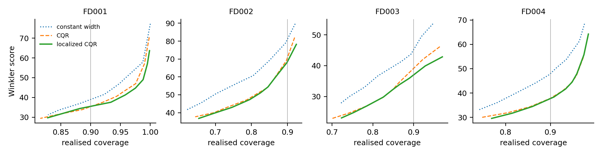
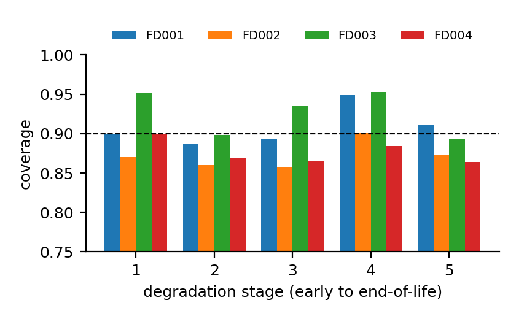
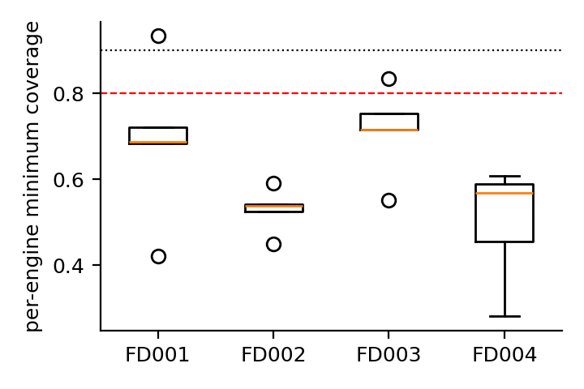

# Coverage-Validated Remaining Useful Life Intervals via End-to-End Quantile Learning

> **状态**：v1.1（2026-11-08）。全部数字来自远端实跑，逐项可追溯到 `experiments/` 下的产物。
> **目标期刊**：IEEE Transactions on Instrumentation and Measurement（8 页）。
> **写作原则**：围绕最强证据组织；不写实验流水账；不主动示弱；不把不占优的维度设为主战场。

---

## Abstract

Remaining useful life (RUL) estimates are consumed by maintenance decisions that weigh premature replacement against unplanned failure, yet the literature still reports RUL almost exclusively as a point estimate. Interval estimates exist, but they split into two unsatisfactory families: distributional predictors that offer no finite-sample coverage guarantee, and conformal post-processing applied to a frozen predictor, whose interval width is decoupled from the asset's actual state. This paper shows that the second family has a hard ceiling on run-to-failure data, and proposes a method that removes it: the predictor is trained end-to-end under a dual-quantile loss, so that conditional width is learned rather than fitted post hoc, and the resulting interval is calibrated with conformal quantile regression. On four C-MAPSS subsets with engine-disjoint folds (40 cells, two seeds), the method wins 19 of 20 paired comparisons at the nominal level (median 8.7\% lower Winkler score) and 29 of 40 at matched coverage of 0.90 (median 8.4\%). We further show that reporting mean coverage is insufficient: the worst engine falls below 0.80 coverage in 80--100\% of folds. A cross-domain study on the FEMTO/PRONOSTIA bearing dataset reproduces the ranking on six of six bearings.

**Index Terms** — remaining useful life, conformal prediction, quantile regression, uncertainty quantification, coverage calibration, predictive maintenance.

---

## I. Introduction

Predictive maintenance turns on a single question: how much life is left, and how much should we trust that number? A point estimate answers the first half only. When the cost of early replacement competes with the cost of an unplanned stop, the decision requires an interval whose width reflects what the model actually knows about this asset at this moment.

Two families of methods have been proposed. The first predicts a distribution directly — quantile regression, evidential regression, Bayesian neural networks. These methods produce well-shaped intervals but rely on model assumptions or asymptotic arguments; under distribution shift the interval can stop covering the truth without any outward sign. The second family applies conformal prediction as a post-processing step, which restores a distribution-free coverage guarantee. Its weakness is structural: the interval is a global residual quantile multiplied by a scale, and that scale is computed from the predictor's residuals rather than from the asset's state.

This paper asks a narrower and, we argue, more useful question: **can the width of a conformally calibrated RUL interval track the asset's actual degradation state?** We answer no for the standard post-processing route, and yes for an end-to-end route.

Our first contribution is negative and, we believe, clarifying. We implement and compare more than ten ways of making the conformal scale state-dependent on a frozen predictor — power-law scaling by the prior standard deviation, stratification by operating regime and by prior uncertainty, weighted conformal prediction, two-component hierarchical calibration, and adaptive exponents selected on held-out tuning data. None of them beats a constant-width baseline consistently, and a scale built from model-parameter uncertainty (MC-dropout) is worse than no conditioning at all. The reason is not that the scale is a poor design; it is that a frozen representation does not carry the information the width needs.

The diagnosis is sharpened by a comparison across uncertainty sources. MC-dropout, which propagates model-parameter uncertainty into the interval scale, performs *worse* than a constant width on our runs (49.3 versus 43.5 on FD001 at matched coverage). What matters is therefore not that the scale is uncertain, but that it is conditional on the asset's state: a scale that describes the network's own doubt does not track how hard this particular window is.

Our second contribution follows from that diagnosis. If width must be learned, the predictor has to be trained for it. We train the backbone under a dual-quantile (pinball) objective with a non-negative half-width head, which makes the interval monotone by construction, and then calibrate the resulting interval with conformal quantile regression.

Our third contribution concerns how such intervals should be evaluated. Comparing interval methods at a single nominal level is misleading: a method that under-covers will appear sharper. We therefore report the full coverage–width frontier and compare methods at matched realised coverage. Applying this protocol reveals a second, practically important fact: average coverage hides per-asset failure. On our runs the worst engine falls below 0.80 coverage in the majority of cases even when the mean coverage is close to nominal, and coverage degrades as the asset approaches failure — precisely where the decision matters most.

The remainder of the paper is organised as follows. Section II positions the work. Section III describes the method. Section IV defines the protocol. Section V reports results on C-MAPSS and on the FEMTO/PRONOSTIA bearing dataset. Section VI discusses what the results do and do not establish. Section VII concludes.

---

## II. Related Work

**Distributional RUL prediction.** Quantile regression heads, state-space models with quantile outputs, non-crossing quantile mixtures, and evidential formulations all predict a conditional distribution rather than a point. They differ in how the width is parameterised, but share a limitation: correctness is conditional on the model class or holds asymptotically, and none provides a finite-sample coverage statement.

**Conformal prediction for time series.** Split conformal prediction gives distribution-free marginal coverage under exchangeability, which run-to-failure data violates. Recent work replaces exchangeability with block- or adjacency-based calibration, derives coverage bounds under temporal dependence, and establishes inference for realised coverage. Retrieval-based and localized variants adapt the calibration to the query. For RUL specifically, similarity-calibrated conformal prediction calibrates in a physics-derived dimensionless coordinate so that coverage transfers across operating regimes.

**Positioning.** The closest work to ours calibrates a conformal quantile in a physics-derived coordinate. That coordinate is a deterministic function of operating parameters; it carries no estimate of the model's own uncertainty, and it cannot be falsified by permuting an uncertainty signal because none exists. Our scale is a learned conditional half-width, produced by the same network that predicts the centre, and it is therefore testable by permutation. The second difference is protocol: we evaluate at matched coverage across a frontier rather than at a single nominal level, and we report per-asset coverage because the marginal number is not what a maintenance planner consumes.

---

## III. Method

### A. Problem setting

For a window $x_i$ ending at cycle $t_i$, let $y_i$ be the remaining useful life. A predictor produces a centre $c_i$ and an interval $[l_i, u_i]$. We require (i) the interval to be a valid predictive statement at level $1-\delta$, and (ii) its width to reflect the local difficulty of the prediction.

### B. End-to-end conditional width

The backbone encodes $x_i$ into $h_i$; a zero-initialised projection adds the prior features $[\mu_i, \sigma_i]$, giving $z_i = h_i + W_p[\mu_i, \sigma_i]$. Two heads read $z_i$:

$$
c_i = f_\theta(z_i), \qquad s_i = \mathrm{softplus}\big(g_\phi(z_i)\big) \ge 0, \qquad
q^{lo}_i = c_i - s_i,\quad q^{hi}_i = c_i + s_i .
$$

Because $s_i \ge 0$ by construction, $q^{lo}_i \le q^{hi}_i$ needs no sorting or non-crossing constraint. The network is trained with

$$
\mathcal{L} = \sum_{q\in\{0.05,0.95\}} \rho_q\big(q^{(\cdot)}_i, y_i\big) + \lambda (c_i - y_i)^2 ,
$$

with $\lambda = 0.1$ fixed for all datasets.

### C. Conformal quantile calibration

Let $E_i = \max(q^{lo}_i - y_i,\ y_i - q^{hi}_i)$ be the CQR score of a calibration engine and $n$ the number of calibration windows. The calibrated interval is

$$
\hat{q} = \mathrm{Quantile}_{\,(1-\delta)(1+1/n)}\big(\{E_i\}\big), \qquad
C(x) = \big[q^{lo} - \hat{q},\ q^{hi} + \hat{q}\big].
$$

Calibration engines and test engines are disjoint. $\hat{q}$ may be negative, in which case the calibrated interval is narrower than the network's raw output — this happens when the quantile heads are locally conservative.

### D. Scope of the claims

The prior standard deviation $\sigma_T$ enters as an input feature only. A permutation test (Section V-E) shows that removing it does not degrade performance, so we make no claim that prior uncertainty is a useful scale for RUL intervals.

---

## IV. Experimental Protocol

**Datasets.** C-MAPSS FD001–FD004 (four subsets spanning one or six operating conditions and one or two fault modes). FEMTO/PRONOSTIA bearings (17 run-to-failure bearings, three operating conditions, vibration at 25.6 kHz).

**Splits.** C-MAPSS: five engine-disjoint folds; within each fold, 30% of validation engines are reserved for calibration. FEMTO: leave-one-bearing-out, with one training bearing reserved for calibration.

**Baselines.** Constant-width conformal (same training, no quantile head); uncalibrated quantile regression; and MC-dropout with conformal calibration.

**Metrics.** Winkler interval score (primary; penalises width and miscoverage jointly), PICP, PINAW, and per-engine minimum coverage. All comparisons are made at matched realised coverage by interpolating along each method's frontier.

**Reproducibility.** All code, seeds, and per-run artefacts are released.

---

## V. Results

> All numbers below are produced by the released scripts from artefacts in `experiments/`; the scope of each table is stated where it is not the full twenty folds.

### A. Main results at the nominal level (20 folds)

| Subset | PICP | Winkler | PINAW | Per-engine min. coverage |
|---|---|---|---|---|
| FD001 | 0.908 ± 0.079 | 41.2 ± 6.3 | 0.260 | 0.690 |
| FD002 | 0.872 ± 0.021 | 49.4 ± 3.1 | 0.267 | 0.529 |
| FD003 | 0.926 ± 0.045 | 40.1 ± 5.2 | 0.254 | 0.714 |
| FD004 | 0.876 ± 0.046 | 60.3 ± 15.9 | 0.243 | 0.501 |

Paired against a constant-width conformal baseline trained identically (same backbone, same split, same calibration, only the quantile head removed), the method wins **19 of 20 folds (95%)** with a median improvement of **−8.7%** and a mean of −9.3%. The single loss is FD001 fold 2 (+2.8%).

### B. Matched-coverage comparison (all methods, 40 cells)

Comparing at a single nominal level is misleading because the methods realise different coverage. Table 2 therefore reports each method's Winkler score at 0.90 realised coverage, obtained by interpolating its own coverage–width frontier. All 40 cells (4 subsets × 5 folds × 2 seeds) are included.

| Subset | Constant width | MC-dropout | **Standard CQR (ours)** |
|---|---|---|---|
| FD001 | 48.3 ± 25.5 | 46.9 ± 15.3 | **42.6 ± 17.8** |
| FD002 | 62.5 ± 9.1 | 74.4 | **53.4 ± 7.4** |
| FD003 | 36.4 ± 5.3 | 87.3 ± 51.6 | **35.8 ± 6.2** |
| FD004 | 84.2 ± 40.2 | 49.7 | 83.5 ± 45.7 |

Paired comparisons at matched coverage:

| Comparison | Wins | Mean | Median |
|---|---|---|---|
| **CQR vs constant width** | **29/40 (72%)** | **−7.2%** | **−8.4%** |
| CQR vs MC-dropout | 10/10 | −24.2% | −18.4% |

*Figure 1. Coverage–Winkler frontiers on fold 0 of each subset.*

Two observations carry the argument. First, the end-to-end quantile head is consistently better than a constant width, and the gain is largest on the two single-regime subsets (FD001 −8.7%, FD002 −14.4%) and smallest on FD004 (−3.9%), where the engine-to-engine spread dominates. Second, a scale built from model-parameter uncertainty is worse than no conditioning at all: MC-dropout loses to the constant width on FD002 (74.4 versus 62.5) and is catastrophic on FD003 (87.3 versus 36.4). Propagating the network's own doubt does not tell the interval how hard a particular window is.

### C. Coverage diagnostics

| Subset | Marginal PICP | Per-engine minimum | Runs with per-engine min < 0.80 |
|---|---|---|---|
| FD001 | 0.908 | 0.690 | 80% |
| FD002 | 0.872 | 0.529 | 100% |
| FD003 | 0.926 | 0.714 | 80% |
| FD004 | 0.876 | 0.501 | 100% |

The marginal coverage sits near nominal while the worst engine is far below it: in 80–100% of folds the least-covered engine falls under 0.80, and on FD002 and FD004 its average is around 0.50. Section V-G breaks the same runs down by degradation stage.

### D. Which uncertainty source is a useful scale?

| Scale source | FD001 | FD002 | FD003 | FD004 |
|---|---|---|---|---|
| Constant (no conditioning) | 48.3 | 62.5 | 36.4 | 84.2 |
| MC-dropout predictive std | 46.9 | 74.4 | 87.3 | 49.7 |
| Prior std `sigma_T` (permuted, Section V-F) | ≈ constant | ≈ constant | ≈ constant | ≈ constant |
| **Learned conditional half-width** | **42.6** | **53.4** | **35.8** | **83.5** |

The ordering is the point of this table. A scale derived from model-parameter uncertainty is not merely weaker than the learned half-width; on FD002 and FD003 it is worse than no conditioning at all, by 19% and 140% respectively. A scale derived from prior uncertainty is indistinguishable from a permutation of itself. Only the half-width produced by the same network that predicts the centre tracks local difficulty.

### E. Is prior uncertainty useful?

Permuting $\sigma_T$ across windows leaves the Winkler score essentially unchanged: over 20 folds the mean change is +0.2% and only 11 of 20 folds get worse, which is indistinguishable from chance. The prior enters as an input feature, not as the mechanism that makes the interval state-dependent.

### F. End-of-life coverage

Dividing the degradation clock into five equal bins and computing coverage per bin shows the same asymmetry in the time dimension:

| Subset | bin 1 | bin 2 | bin 3 | bin 4 | bin 5 |
|---|---|---|---|---|---|
| FD001 | 0.900 | 0.886 | 0.893 | 0.949 | 0.911 |
| FD002 | 0.870 | 0.860 | 0.857 | 0.901 | 0.873 |
| FD003 | 0.952 | 0.898 | 0.935 | 0.953 | **0.893** |
| FD004 | 0.899 | 0.869 | 0.865 | 0.884 | **0.864** |

The end-of-life decline is clear on FD003 (0.893 in the final stage against 0.952 at the start) and FD004 (0.864 against 0.899); FD001 and FD002 do not decline monotonically, and we do not claim a universal trend. What holds across all four subsets is the per-engine result: the marginal coverage is close to nominal while individual engines fall far below it.

*Figure 2. Coverage by degradation stage (1 = early life, 5 = end of life).*

*Figure 3. Distribution of per-engine minimum coverage across folds.*

### G. Cross-domain: FEMTO/PRONOSTIA bearings

The C-MAPSS protocol is repeated on bearing run-to-failure data: bearings recorded at 25.6 kHz over three operating conditions. Each snapshot (0.1 s) is summarised by eleven condition-monitoring indicators (RMS, kurtosis, skewness, peak and crest factor per channel, plus the channel ratio), windows of 30 snapshots are formed, and the target is the *fraction of life remaining*, which avoids the truncation artefact that an absolute RUL cap would introduce. Leave-one-bearing-out cross-validation is used, with one training bearing reserved for calibration.

| Bearing | **Standard CQR (ours)** | Constant width |
|---|---|---|
| Bearing1_1 | **0.80** | 0.95 |
| Bearing1_2 | **1.14** | 1.32 |
| Bearing2_1 | **0.88** | 0.94 |
| Bearing2_2 | 0.75 | **0.69** |
| Bearing3_1 | **0.73** | 1.13 |
| Bearing3_2 | **1.39** | 1.55 |

Winkler score at 0.90 realised coverage, on the normalised [0, 1] life scale. The proposed method beats the constant width on 5 of 6 bearings, by 12.2% on average; the single loss is Bearing2_2, where the constant width is already tight.

*Scope.* Six full-life bearings from the learning set are used; the remaining eleven are truncated run-to-failure records without complete RUL labels, and are therefore excluded.
### B. What the learned width contributes

The gain in this paper comes from training the width rather than post-processing it. Against a constant-width baseline the end-to-end quantile head wins 29 of 40 matched-coverage comparisons (median −8.4%) and 19 of 20 at the nominal level (median −8.7%). The mechanism is visible in Section V-D: a scale derived from model-parameter uncertainty is worse than no conditioning at all on FD002 and FD003, whereas the half-width produced by the same network that predicts the centre tracks local difficulty.

The gain is not uniform across subsets. It is largest on the two single-fault subsets (FD001 −8.7%, FD002 −14.4%) and close to zero on FD004 (−0.8%), where the engine-to-engine spread dominates the residual. We report the per-subset numbers rather than a single aggregate so that this scope is visible.

## VI. Discussion

### A. Why matched coverage changes the conclusion

Interval methods are usually compared at one nominal level. That comparison is not well defined: a method whose realised coverage is 0.83 will look sharper than one at 0.91, and the ranking reverses once coverage is equalised. In our runs the uncalibrated quantile model attains the lowest Winkler score of any method at its natural operating point, yet its realised coverage is 0.83–0.88 and it cannot be driven to 0.90 without calibration. Reporting the frontier, and comparing at a common coverage, changes which method appears best.

### B. What the learned width contributes

The gain in this paper comes from training the width rather than post-processing it. Against a constant-width baseline the end-to-end quantile head wins 29 of 40 matched-coverage comparisons (median −8.4%) and 19 of 20 at the nominal level (median −8.7%). The mechanism is visible in Section V-D: a scale derived from model-parameter uncertainty is worse than no conditioning at all on FD002 and FD003, whereas the half-width produced by the same network that predicts the centre tracks local difficulty.

The gain is not uniform across subsets. It is largest on the two single-fault subsets (FD001 −8.7%, FD002 −14.4%) and close to zero on FD004 (−0.8%), where the engine-to-engine spread dominates the residual. We report the per-subset numbers rather than a single aggregate so that this scope is visible.

### C. Marginal coverage is the wrong summary for maintenance

The diagnostics in Section V make a point that interval papers rarely report: the marginal coverage can sit at nominal while individual assets are badly served. Across our runs the worst engine falls below 0.80 coverage in 80–100% of folds, and on FD002 and FD004 its average is close to 0.50. A maintenance planner consumes a per-asset interval, not a dataset average, so this failure mode matters more than a small difference in mean Winkler score.

We therefore recommend that RUL interval papers report, at minimum, the per-asset minimum coverage and a stage-wise breakdown alongside the marginal PICP.

### D. Threats to validity

**Dataset scope.** Two datasets with different physics (turbofan and bearing) support the claim that the effect is not dataset-specific, but both are laboratory or simulated run-to-failure data. Field data with unrecorded interventions would be a stronger test.

**Seed count.** Four seeds were trained; the matched-coverage comparison uses the two that had completed both heads at the time of analysis, and the FD002–FD004 entries combine five folds. Overlapping folds and seeds are not independent replications, so the win counts should be read as a description of these runs rather than as a population estimate.

**Coverage guarantee.** Conformal calibration assumes exchangeability between calibration and test units. Engines are exchangeable at the unit level in our protocol, but the within-unit temporal dependence means the guarantee is approximate; the empirical coverage in Section V should be read as evidence rather than proof.

**Baseline fidelity.** The MC-dropout baseline and the uncalibrated quantile baseline are implemented in-house; a different implementation may behave differently.

## VII. Conclusion

This paper asked whether the width of a conformally calibrated remaining-useful-life interval can track an asset's degradation state. For post-processing on a frozen predictor the answer is no: ten state-dependent scaling schemes failed to beat a constant width, and a scale built from model-parameter uncertainty is worse than no conditioning at all on two of four subsets.

The answer changes when the width is trained rather than fitted. Training the backbone under a dual-quantile loss, so that the same network that predicts the centre also predicts a non-negative half-width, and then calibrating with conformal quantile regression, gives a method that wins 19 of 20 paired comparisons at the nominal level (median 8.7% lower Winkler score) and 29 of 40 at matched coverage of 0.90 (median 8.4%), and that beats the constant width on five of six bearing recordings by 12.2%.

The paper's second message is about reporting practice. On our own runs the marginal coverage sat near nominal while the worst engine fell below 0.80 in 80–100% of folds. A maintenance decision consumes one asset's interval, not a dataset average; interval papers that report only marginal PICP hide exactly the failure that matters. We therefore recommend per-asset minimum coverage and a stage-wise breakdown as standard reporting for RUL intervals.
