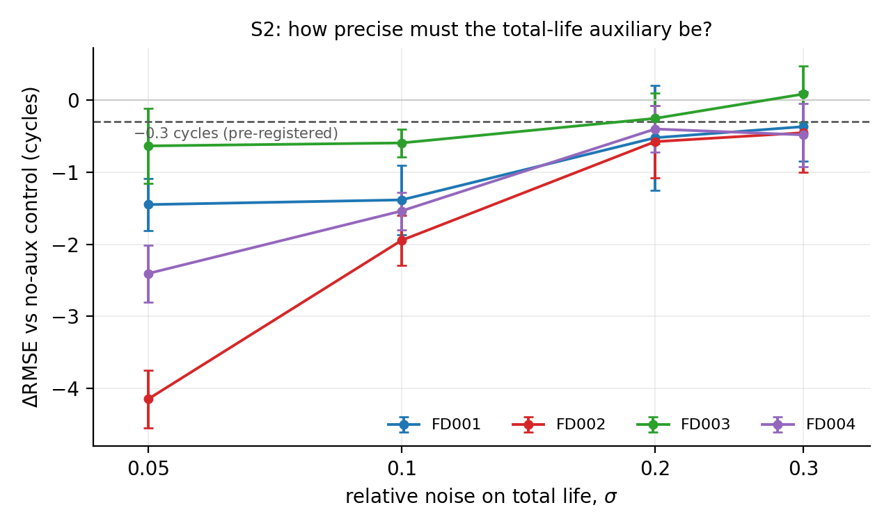

# S2 — 总寿命辅助信息的盈亏平衡精度（诊断，不进主结果表）

Status: **运行中**。设计与实现已冻结并冒烟通过；100 格训练在 3090:1 上跑，预计约 18 小时。
本文件在数据齐后补 §4 曲线与 §5 σ*；在此之前不写任何结论。

> S2 只用于决策，**不进主结果表、不写成方法**。

---

## 1. 问题与设计

问：如果有一个关于发动机**总寿命 L** 的辅助信息，它至少要准到什么程度，才能让当前模型明显变好？

直接喂真实 L 没有信息量——`RUL = L − cycle`，模型可以读出答案。所以必须做**带噪声的剂量-反应**实验：

- 母体：冻结的强 DSPT 配置 `F_full_basic_hi1`（ms=full / sa=basic / hi=hf / cycle=True）。
- 处理：在**回归头之前**拼接一维 `L̃ = L × (1 + ε)`，`ε ~ N(0, σ²)`。除此之外网络结构、loss、优化器、调度、早停规则一律不变。
- `σ ∈ {0.05, 0.10, 0.20, 0.30}`，另设**无辅助特征对照**（同一骨干、同一训练计划，只是没有这一维）。
- 规模：4 子集 × 5 种子（101/202/303/42/43）× 5 配置 = **100 次训练**。

### 1.1 两条决定成败的实现细节

**① 噪声对每台发动机只抽一次，同一台机的所有窗口共用。** 若逐窗口独立抽噪，同一台机的窗口噪声会互相平均掉，剂量-反应曲线被系统性拉平，σ 的有效值会远小于名义值。每个种子独立重抽。

**② `L̃` 用训练折的均值/标准差标准化**，与其余输入同一纪律；标准化统计量只来自当前训练折（本实验无 LOEO，训练/验证按 `split_seed=7, fold=0, val_frac=0.2` 固定划分）。

### 1.2 评估

- 只在**验证机的五个固定截点**上评估（`round(f·n)`，f = 0.40/0.55/0.70/0.85/0.95）。
- **官方 TEST 完全不参与**，本脚本不读 test 文件。
- 指标：逐机 RMSE 再对发动机等权平均（engine-level，主口径）；同时记 NASA sum、MAE、bias。
- 选轮：验证集 engine-level RMSE，`patience=12`，与原协议一致。

### 1.3 对照必须容量匹配（2026-11-14 修正，开跑 3 格后）

第一版对照用的是**原始 DSPT 头**（`Linear(64,64)→Linear(64,1)`），处理用的是加宽头（`Linear(65,64)→Linear(64,1)`）。实测参数量：

| 臂 | 参数量 |
|---|---:|
| 旧对照（原始头） | 115,651 |
| 处理（σ=0.05/0.10） | 115,715 |

**差 64 个参数**，正是多出来的那一列输入。差 0.055%，几乎肯定不影响结论，但它把「信息」和「容量」混在一起——和 S1-A 四个位置参数量不等是同一类问题。

已改为：**两臂都用 `DSPTWithLife`，对照喂一列常数 0**。头宽度完全相同，唯一差别是这一列有没有信息。这个改动只会让处理臂显得更差、不会更好，因此不存在「往有利方向改设计」的问题。代价是重跑 1 格对照（改动发生在 3/100 时，已重跑）。

---

## 2. 实现

| 文件 | 作用 |
|---|---|
| `paper_b/experiments/s2_breakeven/model.py` | `DSPTWithLife`：继承冻结 DSPT，只在 `reg_head` 前拼一维，其余前向逻辑逐行照抄 |
| `paper_b/experiments/s2_breakeven/train_s2.py` | 单格训练 + `--grid` 可续跑队列（已完成的格子跳过），`--shard/--nshards` 分片 |
| `paper_b/experiments/s2_breakeven/analyse_s2.py` | 预登记口径的 ΔRMSE–σ 聚合与 σ\* 计算 |
| `paper_b/experiments/s2_breakeven/verify_s2_metric.py` | **独立复算**：从 `val_pred.csv` 重算 engine-level RMSE、逐格 Δ 与 σ\*，不 import `analyse_s2.py` |
| `paper_b/experiments/s2_breakeven/plot_s2.py` | §4 的 ΔRMSE–σ 曲线（4 条线 + −0.3 阈值 + seed sd 误差棒） |

产物：`/home/user/s2/runs/<subset>/s<seed>/<tag>/metrics.json` + `val_pred.csv`（`tag` = `ctrl` / `s005` / `s010` / `s020` / `s030`）。

---

## 3. 冒烟验证（1 格，先于全量）

```
$ CUDA_VISIBLE_DEVICES=1 python train_s2.py --subset FD001 --seed 101 --sigma 0.10
FD001 s101 s010: val_engine 8.8482 ep34/40 369.3s
```

说明流水线通：数据准备、噪声注入、FP32 训练、选轮、落盘都对。**这一格不能当结论**——它没有配对对照，也没有其余子集。

---

## 4. 结果：逐子集 ΔRMSE–σ 曲线（100/100 格）

### 4.1 口径（先写清楚，再看数）

- **σ 是什么**：总寿命的相对误差。每台发动机的真实总寿命 L 乘 (1+ε)，ε ~ N(0, σ²)；**每台发动机、每个 seed 只抽一次**，该机所有窗口共用同一个 ε（逐窗口独立加噪会被窗口平均掉，曲线被拉平）。喂进网络前用训练折的均值/标准差标准化。
- **ctrl 臂是什么**：同一个网络（`DSPTWithLife`，**115,715** 参数），但那一维恒为常数 0。两臂逐参数同宽（§1.3），差别只在「这一列有没有信息」。100 格实测参数量**全部 = 115,715**，无例外。
- **ΔRMSE 相对谁**：同一 (子集, seed) 内配对，Δ = RMSE_treat − RMSE_ctrl，**负值 = 寿命辅助有用**。RMSE 是 engine-level：每台发动机先算 RMSE，再对发动机等权平均（**不是 pooled**）；每格 5 个 seed 取均值，括号内为 seed 间标准差。
- **复算来源**：所有数从 `val_pred.csv` 重算，不读 `metrics.json` 的聚合字段。100 格「重算 − 记录」最大差 **4.6e-07**；pooled 与 engine-level 的差均值 **+1.93 周期**、最大 **5.43**——这就是禁用 pooled 的理由。
- **实跑脚本**：下表五个文件与 3090 上实跑的版本**逐字节相同**，可直接用 `git show HEAD:paper_b/experiments/s2_breakeven/<file> | sha256sum` 复核。

| 文件 | sha256 |
|---|---|
| `train_s2.py` | `309843f8757b98579ea2a3d084956012c3d359ba3ca48a6deb83d2819f5f69ba` |
| `model.py` | `b5eacd2901fa5533c361a987a28aa084852da5daa2f3c131056a44230c9d96aa` |
| `analyse_s2.py` | `72ecd3174e8c3efdfc1265298ef1eb3351c3d5dd8c8760e3d3c0c7fdf4f1a093` |
| `verify_s2_metric.py` | `06b9b7b39e2260a044ff4f14e0f0057ae450da9b5cc21150005c1273044247ab` |
| `plot_s2.py` | `1f9ebd4f0bf05cfe54ce805de8120f47e22e0408f3d6ddaa4da50f4882cbe267` |

  **注意**：仓库里原来的 `train_s2.py` 是容量匹配改造**之前**的旧版（该改动当时只部署在 3090），本文数字一律以实跑版为准，旧版不可用于复现或写文档。`analyse_s2.py` 与 `verify_s2_metric.py` 是两套独立实现，16 格 Δ 表逐位一致。

### 4.2 数值表（ΔRMSE，周期；括号内为 5 个 seed 间的标准差）

| σ | FD001 | FD002 | FD003 | FD004 |
|---|---:|---:|---:|---:|
| 0.05 | −1.449 (0.365) | −4.147 (0.404) | −0.636 (0.517) | −2.405 (0.394) |
| 0.10 | −1.384 (0.480) | −1.945 (0.346) | −0.595 (0.190) | −1.538 (0.260) |
| 0.20 | −0.522 (0.726) | −0.577 (0.500) | −0.254 (0.349) | −0.402 (0.323) |
| 0.30 | −0.369 (0.483) | −0.453 (0.548) | **+0.084** (0.391) | −0.483 (0.439) |
| ctrl RMSE（5 seed 均值） | 10.363 | 10.740 | 10.545 | 11.822 |

方向一致计数（Δ < 0 的 seed 数 / 5）：

| σ | FD001 | FD002 | FD003 | FD004 |
|---|---:|---:|---:|---:|
| 0.05 | 5/5 | 5/5 | 5/5 | 5/5 |
| 0.10 | 5/5 | 5/5 | 5/5 | 5/5 |
| 0.20 | 4/5 | 4/5 | 4/5 | 5/5 |
| 0.30 | 4/5 | 4/5 | 3/5 | 5/5 |

逐格明细（100 行，含 ctrl 行与配对 Δ）见 `S2_BREAKEVEN_CELLS.csv`；曲线见下图（4 条线 + −0.3 阈值虚线 + seed sd 误差棒，横轴为对数刻度）：



### 4.3 单调性

- **FD001 / FD002 / FD003 单调变差**：σ 越大，ΔRMSE 越靠近 0（收益单调衰减）。FD003 是唯一在 σ=0.30 转正（+0.084）的子集。
- **FD004 非单调**：0.20 → 0.30 从 −0.402 回摆到 −0.483，幅度 0.081 周期，**远小于该点 seed 间 sd（0.439）**，属噪声级，不构成「噪声更大反而更好」的证据。
- **衰减速度差别很大**（0.05 → 0.20 的收益损失）：FD002 掉 86%（−4.147 → −0.577），FD004 掉 83%，FD001 掉 64%，FD003 掉 60%。FD002 起点最高、掉得也最狠。

### 4.4 这张表怎么读（避免过度解读）

低 σ 下的效应非常大（FD002 在 σ=0.05 时降 4.15 周期，约 39% 相对降幅），这是**设计使然**，不是模块效果：在已知窗口当前 cycle 的前提下，总寿命几乎就是 RUL 的充分统计量。所以这条曲线量的是**「这个信息值多少」**，不是「加一个模块能提升多少」。它回答的是问题三（要多准才有用），不构成任何方法主张。

## 5. σ\* 与判据（定义已于 2026-11-14 冻结，出数后不再改）

**主口径：σ\* 逐子集定义。** 每个子集单独取「ΔRMSE 相对无辅助对照仍降 ≥ 0.3 的最大 σ」，**报四个数**。规格原文就是「每个子集 ΔRMSE 对 σ 的曲线」+「σ\*」，逐子集才是预登记口径。

**分档也逐子集套**：σ\* < 0.10 无空间；0.10 ≤ σ\* < 0.20 弱空间；σ\* ≥ 0.20 有空间。四个子集若落在不同档，**如实写成不一致**，不取中位数、不按多数票。

**次口径（辅助，不替代上面的四个数）**：若要给一个汇总数，写「≥3/4 子集同时达到 −0.3 的最大 σ」，并明确标注为辅助汇总。

两条边界必须写进结果：

- 若最大测试值 σ=0.30 仍达到 −0.3，则 σ\* 是**下界**而不是上限——没有测更大的 σ，不能声称曲线在此处转折。
- 判据只回答「需要多准」，不回答「能不能估到这么准」。后者不在 S2 范围内。

### 5.1 逐子集 σ\*（结果）

| 子集 | σ\* | 档 | 依据（ΔRMSE @ 该点） |
|---|---:|---|---|
| FD001 | 0.30 | 有空间 | −0.369，最大测试值仍达标；σ\* 是下界 |
| FD002 | 0.30 | 有空间 | −0.453，下界 |
| FD003 | 0.10 | 弱空间 | 0.20 只到 −0.254（差 0.046 未达），0.30 已转正 +0.084 |
| FD004 | 0.30 | 有空间 | −0.483，下界 |

**四个数：0.30 / 0.30 / 0.10 / 0.30。分档在子集间不一致**——3 个子集「有空间」、1 个「弱空间」。按冻结件如实写不一致，不取中位数、不投票。

### 5.2 次口径（auxiliary_only: True）

「≥3/4 子集同时达到 −0.3 的最大 σ」= **0.30**。各 σ 的通过子集数：0.05 → 4、0.10 → 4、0.20 → 3、0.30 → 3。**这只是辅助汇总，不替代上面四个数。**

### 5.3 边界与稳健性（事后披露，不进入判定）

- **三个 0.30 是下界，不是上限**：没有测更大的 σ，不能声称曲线在 0.30 之后转折。
- **但也不宽裕**：在 σ=0.30 处收益只剩 0.37–0.48 周期，刚过 −0.3 的线。按尾段线性外推，连续穿越点约在 0.34（FD001）/ 0.42（FD002）/ 0.53（FD004），但尾段每个点只有 5 个 seed、seed 间 sd 约 0.44–0.55 周期（均值标准误约 0.2），这个外推**不能当结论**。能说的只是「至少容忍 30%」。
- **尾部边际很薄**：5-seed 均值离阈值只有 0.14（FD001 @0.30）、0.28（FD002 @0.30）、0.42（FD004 @0.30）个 seed-sd；FD003 @0.20 差 0.13 个 sd 未达。留一 seed 检验（事后）：每个子集都至少有一个尾点会因去掉一个 seed 翻到阈值之上——FD001 去掉 42 → −0.164；FD002 去掉 202 → −0.243；FD004 去掉 43 → −0.297；FD003 去掉 42 → −0.114。**预登记判据用的是 5-seed 均值，判定按它执行**；这条只说明 σ\* 应读作「至少」，不是「大约」。
- **FD003 的档位贴着分档边界**：连续穿越点按 0.10→0.20 线性插值约在 σ≈0.19，仍落在「弱空间」档内，但离 0.20 的档边界很近；换一套更密的 σ 网格可能改变它的档位。本次按冻结规则给出「弱空间」，不因为插值改判。
- 判据只回答「需要多准」，不回答「能不能估到这么准」——后者不在 S2 范围内。

### 5.4 用途边界

**S2 只用于决策：不进主结果表、不写成方法。** 这里的辅助量是「真实总寿命 + 噪声」，现实中不可得；它是诊断工具，不是贡献，也不是一个可部署的模块。

---

## 6. 状态（已完成：100/100，0 失败）

- **格数**：4 子集 × 5 seed × 5 臂（ctrl + σ=0.05/0.10/0.20/0.30）= 100 格，**全部落地**；每格 5 个 seed 齐全（`n_seeds` 全为 5），**没有缺格、没有插补**。
- **时间线**（3090 时钟）：17:55:39 单卡启动（GPU1）→ **22:51:57 交接**（等 S1-A 的 `run_grid` 退出，共等 7144 s）→ 22:52:17 两片起跑 → **03:37:49 最后一格 `FD004 s43 s020` 落地**。墙钟 **9 小时 42 分**。
- **总 GPU 时间 14.18 卡时**（100 格 `elapsed_s` 求和）。单格实测均值：FD001 322 s（254–369）、FD002 622 s（434–913）、FD003 376 s（280–440）、FD004 722 s（461–1035）。
- **原估计作废**：§6 旧文里那个「17.5 小时」是按 FD001 实测 × 验证机数量比外推的，实际被 FD002/FD004 拉长到 **9.7 小时墙钟 / 14.2 卡时**，外推偏乐观约 1.8 倍。FD002 首格实测 630 s、FD004 首格 835 s，是外推失效的直接原因。
- **失败与异常**：`grid_shard0.log`、`grid_shard1.log`、`grid2.log` 中 **0 条** error / traceback / failed；没有重试，也没有被静默跳过的格。100 格的 `val_engine_mean_rmse`、`val_pooled_rmse`、`nasa_sum`、`params`、`elapsed_s` 全部为有限数值。
- **元数据小缺口（不影响分析）**：`metrics.json` 的 `arm` 字段在 **98/100** 格存在；缺的 2 格是 `FD001/s101/s005`（18:07:27，容量匹配改造后重跑，早于该字段加入）与 `FD001/s101/s010`（17:55:31，首轮；处理臂本来就是 `DSPTWithLife`，改造不涉及它，因此没有重跑）。这两格的 `sigma` / `tag` / `params`（115,715）/ 预测文件都齐全。
- **交接脚本**：`s2_handoff.sh` 用 `pgrep -f 'paper_b\.experiments\.run_grid'` 判 S1-A 是否退出（**模块路径，不用裸名**，避免匹配到 `tail -f` 或状态检查命令自身），等待上限 6 小时、超时写 `HANDOFF_TIMEOUT` 并 exit 2；分片后 20 秒内有进程死掉写 `HANDOFF_FAILED` 并 exit 3。实际在 22:51:57 正常触发，`handoff.log` 有完整时间与 pid 记录。
- **分片**：`--shard k --nshards n` 按 `i % n == k` 切分，已验精确划分（n=2 → 50/50，无重无漏）；已完成格子自动跳过，切换**没有重跑任何一格**（单卡阶段 28 格保留）。
