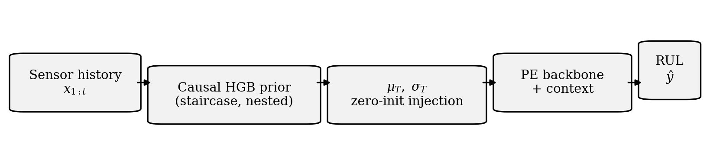
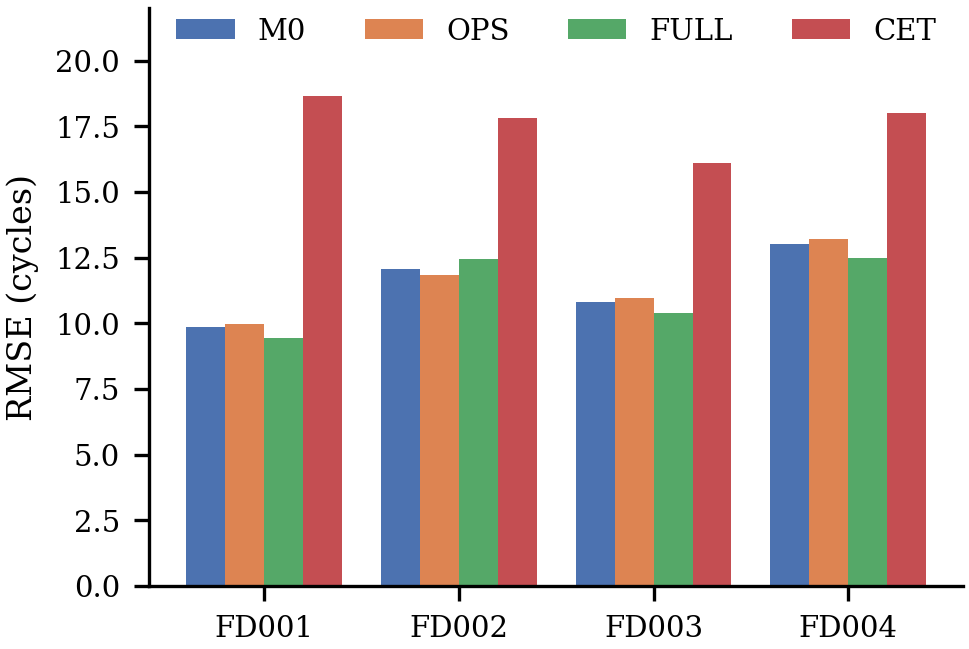
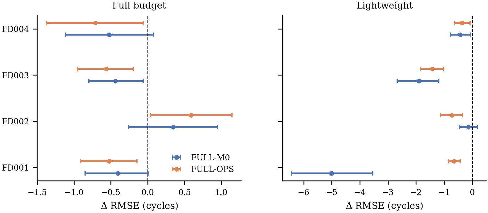
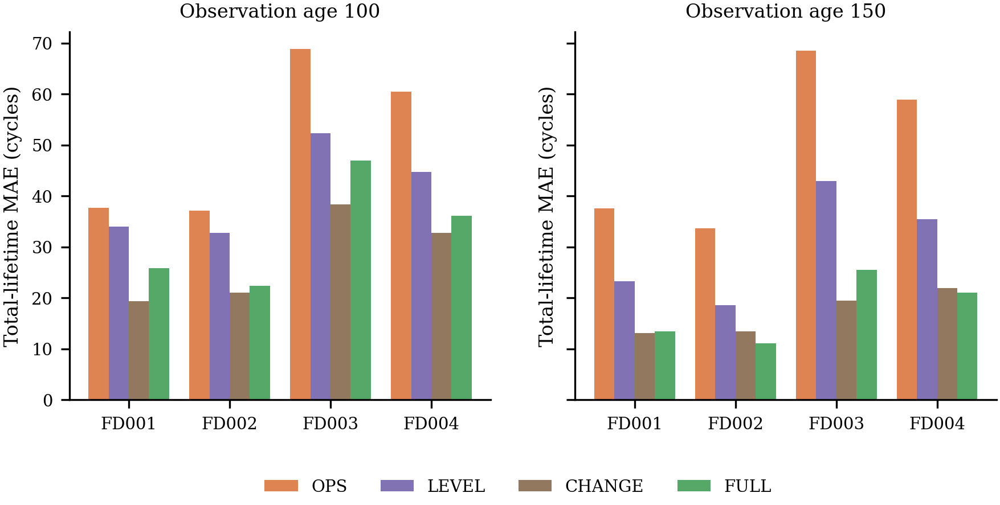
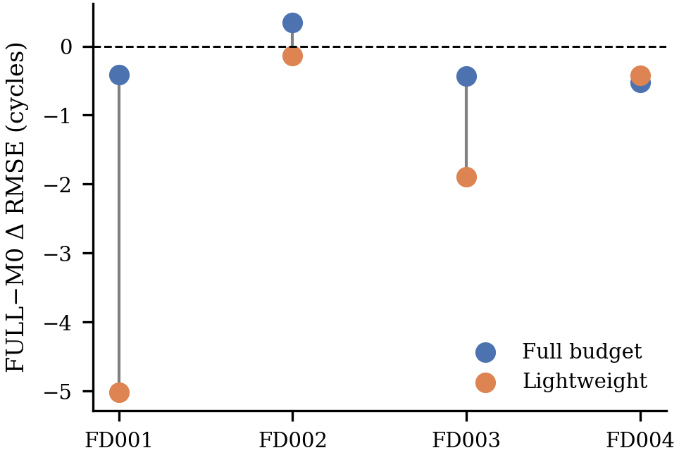

# When Does a Causal Lifetime Prior Help Remaining Useful Life Prediction? A Budget-Controlled Study on C-MAPSS

> Note: the authoritative version is `main.tex` / `main.pdf`. This Markdown draft predates the four-metric Table VIII and the accuracy-safety paragraph; use the PDF for the final numbers.

**Draft manuscript — IEEE TIM — 5 November 2026**  
Author names withheld in this draft.

## Abstract

Lifetime priors estimated from sensor histories are an appealing way to inject engine-specific information into remaining-useful-life (RUL) predictors. Their reported benefit, however, is often measured under a training budget that is not controlled across the compared arms. This paper studies a strictly causal, nested-cross-fitted lifetime prior injected into a positional-encoding (PE) Transformer on the four C-MAPSS subsets. Under a lightweight budget (24 epochs, stride 5), the sensor prior improves over the PE baseline on three of four subsets; under a full budget (80 epochs, all windows), the improvement is significant only on FD003, and on the multi-condition FD002 the sensor prior is significantly worse than an age/condition-only prior (+0.590 RMSE; 95% CI [+0.036, +1.148]). A fixed-age measurement analysis shows that sensor change and slope features carry substantial lifetime information (FULL−OPS MAE reductions of 11.8–42.9 cycles; 8/8 engine-paired CIs below zero), so the negative end-to-end result is not explained by uninformative sensors. We conclude that the RUL benefit of a lifetime prior is budget-dependent, that more sensor information is not uniformly better, and that lifetime-prior studies should report budget-controlled results. The one-shot official test is reported for both budgets; no test-driven tuning is performed.

**Keywords:** remaining useful life, lifetime prior, C-MAPSS, sensor measurement, training budget, negative results, prognostics and health management.

## 1. Introduction

Remaining useful life (RUL) prediction is a central problem in prognostics and health management. On the C-MAPSS turbofan benchmark [1], [2], deep sequence models—convolutional networks, recurrent networks, and Transformers [11]—have become the default backbone, and the IEEE Transactions on Instrumentation and Measurement continues to publish new architectures and uncertainty layers for this task [3]–[10].

A recurring idea is to give the predictor an explicit estimate of *how long this engine will live*. If a lifetime estimator can infer an engine-specific total lifetime μ_T from its sensor history, then the predictor can be told, in effect, “this engine is a short-life or a long-life unit,” and the RUL target can be normalized by that identity. The appeal is that lifetime is a low-dimensional, engine-specific quantity that is more stable than the RUL trajectory itself. The idea has appeared under several names: lifetime priors, survival priors, engine-specific normalization, and degradation clocks.

The evidence for the idea, however, is easily confounded. A prior is usually added to a backbone that is trained with a particular budget: a number of epochs, a window stride, an early-stopping rule, and an evaluation split. If the prior arm is trained with a different budget from the baseline, or if the baseline is stopped on the same outer-validation set that is used for reporting, the measured gain can reflect the budget and the selection rule rather than the prior. The problem is not hypothetical: in the project that motivated this study, the same prior looked strong under a short, early-stopped protocol and weak under a longer, fixed protocol. The literature rarely reports both.

This paper asks a measurement question rather than proposing a new architecture: *when does a causal lifetime prior help RUL prediction, and when does it not?* We build a strictly causal, nested-cross-fitted lifetime prior, inject it into a PE backbone through a zero-initialized linear layer, and compare four arms—no prior (M0), an age/condition-only prior (OPS), a sensor prior (FULL), and an adapted CET-MSA baseline—on all four C-MAPSS subsets, three seeds, and two fixed training budgets. The official test set is sealed, predicted once, and opened once. We also run a fixed-age measurement analysis that asks whether sensor histories contain lifetime information at all, independent of the end-to-end RUL model.

The main findings are as follows.

1. Under the full budget (80 epochs, all windows), the sensor prior does *not* reliably beat the PE baseline: FULL−M0 is significant only on FD003; FD001 is not significant (CI upper +0.010), FD002 is worse (not significant), and FD004 is not significant. On FD002, FULL is significantly *worse* than the age/condition-only prior (+0.590, CI [+0.036, +1.148]).
2. Under the lightweight budget (24 epochs, stride 5), the sensor prior improves over M0 on FD001, FD003, and FD004, but not on FD002; FULL−OPS is significant on all four subsets. The lightweight absolute RMSE is far worse than the full-budget one, so this regime is a controlled contrast, not a performance table.
3. The benefit is therefore budget-dependent. The three-seed outer-validation replication in the lightweight regime supports the prior (FULL−OPS significant on all four subsets), while the full-budget one-shot test removes most of the gain and reverses FD002. The two results are not contradictory; they measure different training regimes.
4. The sensor information itself is real. At fixed observation ages of 100 and 150 cycles, sensor change and slope features reduce total-lifetime MAE by 11.8–42.9 cycles relative to age/condition features, and all eight engine-paired CIs exclude zero. The negative end-to-end result is thus not explained by uninformative sensors; it is a property of the end-to-end interface and the budget.
5. Uncertainty is not supported by the current prior: the prior’s σ_T is numerically degenerate (maximum 5.68×10⁻¹⁴), the Gate 2 Spearman correlation on FD002 is 0.034, and a post-hoc conformal layer is over-conservative (width 33–83 cycles at 90% coverage). We do not claim calibrated uncertainty.

The contributions are fourfold. First, we give a strictly causal, nested-cross-fitted lifetime prior with a staircase cutoff construction and explicit leakage tests. Second, we provide a fixed-age measurement analysis that separates age/condition, level, change, and full sensor information, showing that sensor change and slope features carry substantial lifetime information. Third, we report a budget-controlled, one-shot official-test evaluation that compares a lightweight and a full training recipe and shows that the prior's end-to-end benefit is not robust. Fourth, we draw practical implications for how lifetime-prior studies should be reported: the training budget, the checkpoint rule, and the evaluation split must be controlled, and more sensor information is not uniformly better. The paper is a measurement study of a causal lifetime prior, not a new state-of-the-art RUL model. Section 2 reviews related work; Section 3 describes the prior, the injection, and the measurement analysis; Section 4 gives the protocol; Section 5 reports the one-shot official test, the replication, the measurement analysis, and the baselines; Section 6 discusses why the benefit is budget-dependent; Section 7 concludes.

## 2. Related Work

### 2.1 RUL prediction on C-MAPSS

C-MAPSS [1], [2] remains the most widely used turbofan RUL benchmark; [18] reviews the early algorithmic approaches. Early work used recurrent networks [19] and classical regression models; subsequent work moved to LSTM [20] and deep convolutional networks [21]. Temporal convolutional networks and attention-based models are common, and Transformer variants have been applied to both C-MAPSS and N-CMAPSS [10], [8]. Recent TIM papers have focused on uncertainty quantification [3], [4], domain adaptation [5], degradation modeling [7], [6], and reviews of the field [9]. The present paper does not compete on architecture; it asks how a lifetime prior should be evaluated against a strong PE backbone.

### 2.2 Lifetime priors and engine-specific information

The idea of estimating an engine’s lifetime and using it as a prior has appeared in survival analysis, transfer learning, and degradation-modeling work. The closest operational form is a two-stage estimator: first estimate a lifetime or health scale from the observed prefix, then condition the RUL model on it. The prior can be a scalar (expected lifetime), a vector (lifetime and uncertainty), or a clock (normalized time). The project that motivated this study used a gradient-boosted lifetime estimator and a zero-initialized injection; the present paper generalizes that design into a controlled comparison of age/condition and sensor priors.

### 2.3 Sensor measurement and degradation features

Sensor histories contain both level information (how far the current reading is from a healthy reference) and change information (how fast the reading is moving). The measurement analysis in Section 3.6 separates these sources: OPS uses age and operating conditions, LEVEL adds recent sensor means, CHANGE adds late-minus-early means and a recent slope, and FULL adds all sensor summaries. This decomposition is motivated by the degradation literature, where change and slope features are often more informative than absolute levels.

### 2.4 Evaluation and negative results

RUL papers typically report RMSE and the NASA score [2], often with a cap of 125 cycles. The training budget, the early-stopping rule, and the evaluation split are less often controlled. Negative results are rare. This paper follows a pre-registered, one-shot protocol: all predictions are sealed before the official labels are read, and both the lightweight and full-budget tables are reported. The historical E22a numbers (9.82/11.51/10.06/11.79) are from a different protocol and are reported only as context.

## 3. Causal Lifetime Prior

### 3.1 Problem setting

For engine *i*, let x_{1:t} be the sensor history up to cycle *t*, and let T_i be the (unknown) total lifetime. The RUL target is

  y_{i,t} = min(T_i − t, 125),

and the predictor observes a window of length 50 ending at *t*. The official test provides one truncated prefix per engine and one target at its last observed cycle.

### 3.2 Lifetime estimator

The prior is a HistGradientBoosting regressor [12] trained on causal prefix features at a cutoff *c*: age, operating-condition statistics, and sensor moments and slopes computed from rows 1..c only. The cutoff grid is c ∈ {50, 60, …, 200}, and a window ending at *t* consumes the latest cutoff c ≤ t (staircase construction, no interpolation to future cutoffs). The estimator is nested: an outer five-fold engine split, an inner four-fold cross-fit inside each outer-training partition, and a five-seed ensemble. The output is a point lifetime μ_T and an uncertainty σ_T (the seed standard deviation). The construction is identical for OPS and FULL; the only difference is the feature set (age and operating conditions for OPS; all sensor summaries for FULL).

### 3.3 Injection

The prior is injected into a PE backbone (d_model 64, one Transformer layer, 42.3k parameters) through a zero-initialized linear layer added to the pooled context:

  h = PE(x_{1:t}),  ŷ = head(h̄ + W[μ_T/250, σ_T/250]),

with W initialized to zero. At initialization every prior arm is exactly the PE baseline; the learned difference is attributable to the prior signal. M0 has no injection, OPS and FULL use the same two-dimensional injection, and CET is an adapted CET-MSA baseline [16] trained under the same budget.

### 3.4 Leakage controls

Four tests guard the construction: perturbing sensors after cycle *t* must not change μ_T(t); perturbing an outer-validation engine’s true lifetime must not change the outer-training prior or that engine’s own prior; and every consumed cutoff must satisfy c ≤ t. The implementation also checks prefix-truncation invariance, future-perturbation invariance, endpoint equivalence, and short-prefix handling; all four subsets pass. The official test labels are never used for prior fitting.

### 3.5 Why a lifetime prior?

The motivation is that lifetime identity is more learnable than the RUL trajectory. With the same causal features, a direct HGB RUL regressor is much worse than the PE backbone, while the prior-implied RUL is intermediate. The prior therefore carries information that the backbone can use, but the end-to-end benefit depends on whether the backbone has already learned that information from its own sensors.

### 3.6 Fixed-age measurement analysis

To test whether sensor histories contain lifetime information independently of the RUL model, we estimate the *uncapped total lifetime* at fixed observation ages of 100 and 150 cycles. At a fixed age, estimating total lifetime and estimating uncapped RUL have the same absolute error, so the MAE is a clean measurement of lifetime information. Four feature sets are compared: OPS (age and operating conditions), LEVEL (recent 15-cycle sensor means), CHANGE (late-minus-early means and a 40-cycle slope), and FULL (all sensor summaries). The estimator is the same HGB, fitted on outer-training engines and evaluated on outer-validation engines; intervals are engine-paired bootstrap resamples. This analysis is descriptive and does not by itself imply end-to-end RUL superiority.

## 4. Experimental Protocol

### 4.1 Data and folds

We use the four C-MAPSS training subsets: FD001 (100 engines, one condition, one fault mode), FD002 (260 engines, six conditions), FD003 (100 engines, two fault modes), and FD004 (249 engines, six conditions, two fault modes). The official test sets contain 100, 259, 100, and 248 engines, respectively. The target is capped at 125 cycles; the window is 50 cycles; 14 sensors are used. The outer split is an engine-level five-fold partition with a fixed seed (20261104); the same partition is used for the prior, every arm, and the measurement analysis. Scalers are fit on outer-training engines only.

### 4.2 Budgets

Two fixed recipes are used. The *lightweight* recipe trains for exactly 24 epochs with stride 5 and evaluates the final checkpoint; the *full* recipe trains for exactly 80 epochs with all windows (stride 1) and evaluates the final checkpoint. Neither recipe selects an epoch on the outer-validation set. Both use AdamW [13], a cosine schedule, batch 256, and the same asymmetric late-penalty loss. The lightweight recipe is a controlled contrast; the full recipe is the performance table.

### 4.3 Arms, seeds, and metrics

The arms are M0 (PE), OPS (age/condition prior), FULL (sensor prior), and CET (adapted CET-MSA), summarized in Table 2. Seeds are 101, 202, and 303. The primary metric is RMSE in cycles; MAE, signed bias, and the NASA score are also reported. Deltas are engine-paired with 5,000 bootstrap resamples (seed 99); a CI that excludes zero is marked significant.

### 4.4 One-shot official test

All official-test predictions are generated and hashed before any label is read. The 96 prediction files (four subsets × four arms × three seeds × two budgets) are sealed, and the labels are opened exactly once by a single scoring script. No model, recipe, arm, or budget is changed after opening. The full-budget table is the main result; the lightweight table is the controlled contrast; the historical E22a and IDA numbers are a different caliber and are not compared.

## 5. Results

### 5.1 The full-budget official test does not support a robust gain

Table 1 reports the full-budget official test. The PE baseline is strong: 9.852 (FD001), 12.084 (FD002), 10.823 (FD003), and 13.010 (FD004). FULL is better than M0 on FD001, FD003, and FD004 in point estimate, but the CI excludes zero only on FD003 (−0.437, [−0.799, −0.060]). On FD001 the CI upper is +0.010, i.e., it just crosses zero; on FD004 the CI is [−1.114, +0.080]; on FD002 FULL is worse than M0 (+0.348, [−0.259, +0.948]). The sensor prior therefore does not reliably beat the PE baseline under the full budget.

The more informative contrast is FULL−OPS. On FD001, FD003, and FD004 the sensor prior is better than the age/condition prior (−0.526, −0.566, −0.710, all significant). On FD002 it is significantly *worse* (+0.590, [+0.036, +1.148]). The age/condition prior is also the best arm on FD002 (11.842 vs 12.084 for M0 and 12.432 for FULL). This is the central negative result: more sensor information is not uniformly better, and on the multi-condition subset it is harmful relative to a simpler prior.

**Table 1. Official test, full-budget recipe (80 epochs, all windows).** RMSE in cycles; 95% CI from 5,000 engine-paired bootstrap resamples. Bold: CI excludes zero. CET is the adapted CET-MSA, not the authors’ official protocol.

| Subset | M0 | OPS | FULL | CET | FULL−M0 [95% CI] | FULL−OPS [95% CI] |
|---|---:|---:|---:|---:|---|---|
| FD001 | 9.852 | 9.968 | 9.443 | 18.668 | −0.409 [−0.850, +0.010] | **−0.526 [−0.913, −0.146]** |
| FD002 | 12.084 | 11.842 | 12.432 | 17.831 | +0.348 [−0.259, +0.948] | **+0.590 [+0.036, +1.148]** |
| FD003 | 10.823 | 10.952 | 10.386 | 16.112 | **−0.437 [−0.799, −0.060]** | **−0.566 [−0.952, −0.196]** |
| FD004 | 13.010 | 13.196 | 12.486 | 18.002 | −0.524 [−1.114, +0.080] | **−0.710 [−1.377, −0.053]** |

**Table 2. Arms and budgets.** The lightweight recipe is a controlled contrast; the full recipe is the performance table. Both use a fixed final checkpoint and no outer-validation epoch selection.

| Arm | Prior features | Injection | Role |
|---|---|---|---|
| M0 | none | none | PE baseline |
| OPS | age, operating conditions | [μ_T, σ_T] zero-init | age/condition control |
| FULL | age, conditions, sensor summaries | [μ_T, σ_T] zero-init | sensor prior |
| CET | adapted CET-MSA | architecture | external baseline |

### 5.2 The lightweight regime shows a benefit

Table 3 reports the lightweight official test. FULL−M0 is significant on FD001 (−5.017), FD003 (−1.898), and FD004 (−0.427), but not on FD002 (−0.134, [−0.454, +0.181]). FULL−OPS is significant on all four subsets (−0.649, −0.729, −1.423, −0.358). The lightweight absolute RMSE is much worse (FD001 17.194, FD002 12.864, FD003 15.140, FD004 12.636 for FULL), so this table is a controlled contrast, not a performance claim. The contrast shows that the prior can help when the backbone is budget-limited, and that the sensor prior is better than the age/condition prior in that regime.

**Table 3. Official test, lightweight recipe (24 epochs, stride 5).** RMSE in cycles; 95% CI from 5,000 engine-paired bootstrap resamples. Bold: CI excludes zero.

| Subset | M0 | OPS | FULL | CET | FULL−M0 [95% CI] | FULL−OPS [95% CI] |
|---|---:|---:|---:|---:|---|---|
| FD001 | 22.211 | 17.843 | 17.194 | 16.655 | **−5.017 [−6.434, −3.539]** | **−0.649 [−0.849, −0.432]** |
| FD002 | 12.997 | 13.593 | 12.864 | 21.646 | −0.134 [−0.454, +0.181] | **−0.729 [−1.119, −0.349]** |
| FD003 | 17.038 | 16.563 | 15.140 | 16.386 | **−1.898 [−2.671, −1.186]** | **−1.423 [−1.833, −1.010]** |
| FD004 | 13.063 | 12.994 | 12.636 | 22.283 | **−0.427 [−0.777, −0.070]** | **−0.358 [−0.634, −0.075]** |

### 5.3 Per-seed variability

Table 4 gives the per-seed full-budget contrasts. FD001 and FD003 are consistently negative across seeds. FD002 is mixed: seed 101 is +0.146, seed 202 is −0.122, and seed 303 is +0.819; the ensemble is +0.348 with a CI crossing zero. FD004 is negative on all three seeds (−0.086, −1.022, −0.964), but the ensemble CI crosses zero. The per-seed view is important: a pooled mean can hide a sign reversal, and the FD002 result is not a single-seed accident.

**Table 4. Per-seed FULL−M0 and FULL−OPS on the official test, full-budget recipe.**

| Subset | Seed | FULL | M0 | FULL−M0 [95% CI] | FULL−OPS [95% CI] |
|---|---|---:|---:|---|---|
| FD001 | 101 | 9.751 | 9.991 | −0.241 [−0.940, +0.459] | −0.331 [−0.862, +0.191] |
| FD001 | 202 | 9.518 | 9.874 | −0.356 [−0.760, +0.015] | −0.595 [−0.946, −0.233] |
| FD001 | 303 | 9.474 | 10.112 | −0.637 [−1.070, −0.163] | −0.546 [−0.933, −0.181] |
| FD002 | 101 | 12.960 | 12.813 | +0.146 [−0.658, +0.988] | +0.256 [−0.748, +1.270] |
| FD002 | 202 | 12.756 | 12.877 | −0.122 [−1.106, +0.881] | +0.496 [−0.228, +1.299] |
| FD002 | 303 | 13.399 | 12.580 | +0.819 [−0.141, +1.776] | +1.047 [+0.234, +1.845] |
| FD003 | 101 | 10.676 | 10.930 | −0.254 [−0.692, +0.188] | −0.494 [−0.881, −0.109] |
| FD003 | 202 | 10.684 | 11.086 | −0.401 [−0.684, −0.102] | −0.598 [−0.983, −0.263] |
| FD003 | 303 | 10.112 | 10.838 | −0.726 [−1.364, −0.101] | −0.641 [−1.318, −0.017] |
| FD004 | 101 | 13.004 | 13.090 | −0.086 [−1.184, +1.013] | −1.886 [−3.139, −0.637] |
| FD004 | 202 | 13.070 | 14.093 | −1.022 [−2.172, +0.083] | −0.244 [−1.319, +0.844] |
| FD004 | 303 | 13.051 | 14.016 | −0.964 [−1.611, −0.319] | −0.529 [−1.059, +0.021] |

*Note: the per-seed CIs in this table are from the single-seed contrast script; the ensemble CIs in Table 1 are the primary inference. The table is included to expose sign reversals.*

### 5.4 The sensor information is measurable

Table 5 reports the fixed-age total-lifetime MAE. At age 150, CHANGE reduces the MAE from 37.64 to 13.12 on FD001, from 33.71 to 13.43 on FD002, from 68.50 to 19.46 on FD003, and from 58.92 to 22.00 on FD004; FULL is similar or better. The FULL−OPS reductions are 11.79, 24.21, 14.81, 22.61, 21.86, 42.93, 24.34, and 37.86 cycles across the eight subset–age cells, and all eight engine-paired CIs exclude zero. Sensor change and slope features therefore carry substantial lifetime information. The negative end-to-end result in Table 1 is not due to uninformative sensors; it is a property of how that information is consumed by a full-budget RUL model.

**Table 5. Fixed-age total-lifetime MAE (cycles) on outer-validation engines.** OPS: age and operating conditions; LEVEL: recent 15-cycle sensor means; CHANGE: late-minus-early means and 40-cycle slope; FULL: all sensor summaries. Bold: FULL−OPS CI excludes zero.

| Subset | Age | n | OPS | LEVEL | CHANGE | FULL | FULL−OPS [95% CI] |
|---|---:|---:|---:|---:|---:|---:|---|
| FD001 | 100 | 100 | 37.69 | 34.03 | 19.36 | 25.90 | **−11.79 [−16.55, −7.20]** |
| FD001 | 150 | 94 | 37.64 | 23.30 | 13.12 | 13.43 | **−24.21 [−29.18, −19.31]** |
| FD002 | 100 | 260 | 37.19 | 32.83 | 21.10 | 22.38 | **−14.81 [−18.09, −11.40]** |
| FD002 | 150 | 240 | 33.71 | 18.64 | 13.43 | 11.10 | **−22.61 [−25.76, −19.47]** |
| FD003 | 100 | 100 | 68.84 | 52.38 | 38.38 | 46.98 | **−21.86 [−31.29, −12.37]** |
| FD003 | 150 | 98 | 68.50 | 42.96 | 19.46 | 25.57 | **−42.93 [−51.36, −34.74]** |
| FD004 | 100 | 249 | 60.53 | 44.69 | 32.77 | 36.19 | **−24.34 [−29.67, −19.41]** |
| FD004 | 150 | 238 | 58.92 | 35.51 | 22.00 | 21.06 | **−37.86 [−42.42, −33.20]** |

### 5.5 Replication and the budget interaction

Table 6 reports the three-seed outer-validation replication in the lightweight regime. FULL−OPS is significant on all four subsets (−0.425, −0.616, −1.172, −0.836); FULL−M0 is significant on FD001, FD002, FD003, and FD004 (−4.285, −0.542, −11.688, −0.467). This is a positive result for the prior in the lightweight regime, and it is consistent with Table 3. The full-budget official test (Table 1) is the same method under a stronger budget; the gain shrinks and FD002 reverses. The two results measure different regimes, and the difference is the paper’s main empirical finding.

**Table 6. Three-seed outer-validation replication (24-epoch recipe), engine-pooled RMSE.** Bold: CI excludes zero.

| Subset | M0 | OPS | FULL | CET | FULL−OPS [95% CI] | FULL−M0 [95% CI] |
|---|---:|---:|---:|---:|---|---|
| FD001 | 41.453 | 37.592 | 37.168 | 15.909 | **−0.425 [−0.490, −0.364]** | **−4.285 [−4.612, −3.939]** |
| FD002 | 16.863 | 16.937 | 16.321 | 20.684 | **−0.616 [−0.699, −0.537]** | **−0.542 [−0.635, −0.454]** |
| FD003 | 32.602 | 22.087 | 20.915 | 17.658 | **−1.172 [−1.424, −0.924]** | **−11.688 [−12.340, −11.049]** |
| FD004 | 17.244 | 17.613 | 16.777 | 23.323 | **−0.836 [−0.997, −0.681]** | **−0.467 [−0.667, −0.267]** |

### 5.6 Baselines and historical context

The adapted CET-MSA is not competitive in the full-budget protocol: its RMSE is 18.668, 17.831, 16.112, and 18.002 on FD001–FD004, worse than both M0 and FULL. In the lightweight protocol it is 16.655, 21.646, 16.386, and 22.283; it is competitive on FD001 and FD003 but much worse on FD002 and FD004. The adapted CET is not the authors’ official protocol: the official CET-MSA reproduction (cap 150, official code and configs) is 17.22, 22.41, 16.55, and 21.78, and the BootBoGs-TS official results for FD004 are 24.39 (proposed), 22.42 (Bayes), 18.29 (random), and 27.37 (grid). These numbers are context, not a like-for-like comparison; the historical E22a numbers (9.82/11.51/10.06/11.79) are from a different, early-stopped protocol.

The old IDA context is reported in Table 7: under the early-stopped outer-validation protocol, M1 (the sensor prior) improves over M0 on FD002 (12.280 vs 12.559) and FD004 (12.242 vs 12.717). Those numbers are not comparable to the one-shot official test, and they are exactly the kind of result that the budget-controlled design is meant to check. The six-seed means in the old line (FD001 9.845/9.918/9.862; FD002 12.754/12.311/12.320) are also a different aggregation.

**Table 7. Historical IDA context (seed 101, outer-validation, early-stopped protocol).** Different caliber from the one-shot official test; not comparable.

| Subset | n | M0 | M1 | M1p | Gate 2 ρ | max σ_T |
|---|---:|---:|---:|---:|---:|---:|
| FD001 | 100 | 9.915 | 9.811 | 9.959 | 0.0525 | 2.84×10⁻¹⁴ |
| FD002 | 260 | 12.559 | 12.280 | 12.217 | 0.0340 | 2.84×10⁻¹⁴ |
| FD003 | 100 | 9.806 | 9.702 | 9.943 | −0.1033 | 5.68×10⁻¹⁴ |
| FD004 | 249 | 12.717 | 12.242 | 12.721 | −0.0364 | 2.84×10⁻¹⁴ |

### 5.7 Uncertainty

The prior’s σ_T is numerically degenerate: the maximum is 2.84×10⁻¹⁴ on FD001/FD002/FD004 and 5.68×10⁻¹⁴ on FD003. The Gate 2 Spearman correlation between σ_T/μ_T and the absolute lifetime error is 0.034 on FD002, 0.053 on FD001, −0.103 on FD003, and −0.036 on FD004; the pre-registered threshold of 0.3 is not met. A post-hoc Mondrian conformal layer calibrated on the lightweight outer-validation predictions gives 90% intervals with coverage 0.88–1.00 but widths of 33–83 cycles; on FD001 the width is about 80 cycles, which is over-conservative for a full-budget model. We therefore do not claim calibrated uncertainty; the σ_T channel is effectively uninformative, and the conformal layer is reported only as a caveat.

## 6. Discussion

### 6.1 Why the benefit is budget-dependent

A lifetime prior adds information that the backbone may or may not already have. Under the lightweight budget the PE backbone is underfit; the prior supplies a low-dimensional summary that the backbone cannot extract from 24 epochs, and the gain is visible. Under the full budget the backbone has enough capacity and data to learn the degradation signal; the prior’s sensor summary is partly redundant, and on FD002 its extra features are harmful relative to the simpler age/condition prior. The mechanism is consistent with the measurement analysis: the sensor information is real (Table 5), but a full-budget RUL model does not need all of it, and the wrong summary can hurt.

### 6.2 More sensor information is not uniformly better

The FD002 result is the clearest counterexample to the “more sensors, more features, better RUL” intuition. The age/condition prior is the best arm on FD002 under the full budget, while the sensor prior is significantly worse than it. A measurement study that only reports the lightweight regime would have concluded the opposite. This is why the paper reports both budgets and the per-seed table.

### 6.3 Implications for reporting

Lifetime-prior papers should report the training budget, the checkpoint rule, and the evaluation split for every arm; they should report both a controlled contrast and a performance table; and they should not assume that a prior that helps in a weak regime helps in a strong one. Negative results are informative: the absence of a robust gain is a finding about the interface, not a failure to tune.

### 6.4 Limitations

The study uses one simulated benchmark (C-MAPSS), one backbone family, and handcrafted sensor summaries; it does not test cross-domain transfer or real flight data. The full-budget official test is a single protocol; the lightweight replication is a different regime, not an independent confirmation of the full-budget result. The prior is an external HGB, not an end-to-end module; the CET baseline is an adaptation, not the authors’ official protocol. The uncertainty analysis is negative, and the conformal layer is over-conservative. These limitations bound the claims: the paper is a budget-controlled measurement study, not a universal statement about lifetime priors.

## 7. Conclusion

A causal, engine-specific lifetime prior is informative for lifetime estimation, but its end-to-end RUL benefit is budget-dependent. Under a lightweight budget the sensor prior improves over the PE baseline on three of four C-MAPSS subsets; under a full budget the gain is significant only on FD003, and on FD002 the sensor prior is significantly worse than an age/condition-only prior. The sensor information itself is real: fixed-age measurement shows 11.8–42.9 cycle MAE reductions with 8/8 engine-paired CIs. The paper argues for budget-controlled reporting and for treating lifetime priors as measurement instruments whose value depends on how much the backbone already knows.

## Appendix A. Protocol and audit

The official-test predictions were sealed in 96 files (four subsets, four arms, three seeds, two budgets) and hashed before any label was read. The labels were opened once by a single scoring script; no test-driven fitting followed. The full-budget and lightweight recipes are fixed (80 epochs/stride 1 and 24 epochs/stride 5), both with a final checkpoint and no outer-validation epoch selection. The historical E22a and IDA numbers are a different caliber and are reported only as context. C-MAPSS is public. The code, protocols, the 96 sealed predictions, and their hashes are archived with the paper.

## References

[1] A. Saxena, K. Goebel, D. Simon, and N. Eklund, “Damage propagation modeling for aircraft engine run-to-failure simulation,” in *Proc. Int. Conf. Prognostics Health Manage.*, 2008.

[2] A. Saxena et al., “Metrics for offline evaluation of prognostic performance,” *Int. J. Prognostics Health Manage.*, vol. 1, no. 1, 2010.

[3] S. Piao, R. Huang, and F. Tsung, “CRULP: Reliable RUL estimation inspired by conformal prediction,” *IEEE Trans. Instrum. Meas.*, vol. 74, Art. 3505411, 2025.

[4] S. Piao, Y. Wang, R. Huang, D. Wang, and F. Tsung, “Quantify uncertainty beyond covariate shift in RUL estimation by conformal prediction,” in *Proc. IEEE CASE*, 2025.

[5] Y. Hou et al., “Evidential domain adaptation for remaining useful life prediction with incomplete degradation,” *IEEE Trans. Instrum. Meas.*, 2025.

[6] N. Yang et al., “A method for remaining useful life prediction and uncertainty quantification of rolling bearings based on fault feature gain,” *IEEE Trans. Instrum. Meas.*, 2025.

[7] X. Wang, X. Si, X. Xi, and D. Zhou, “Adaptive remaining useful life prediction based on a system-level variable structure degradation model,” *IEEE Trans. Instrum. Meas.*, vol. 74, 2025.

[8] E. Kim et al., “Enhanced remaining useful life prediction for turbofan engines using spatiotemporal Koopman dual-branch transformer,” *IEEE Trans. Instrum. Meas.*, vol. 74, 2025.

[9] J. Zhou, J. Yang, S. Xiang, and Y. Qin, “Remaining useful life prediction methodologies with health indicator dependence for rotating machinery: A comprehensive review,” *IEEE Trans. Instrum. Meas.*, vol. 74, 2025.

[10] J.-P. Noot, M. Martin, and E. Birmelé, “LSTM and transformers based methods for remaining useful life prediction considering censored data,” *Int. J. Prognostics Health Manage.*, vol. 16, no. 2, 2025.

[11] A. Vaswani et al., “Attention is all you need,” in *Adv. Neural Inf. Process. Syst.*, vol. 30, 2017.

[12] J. H. Friedman, “Greedy function approximation: A gradient boosting machine,” *Ann. Statist.*, vol. 29, no. 5, pp. 1189–1232, 2001.

[13] D. P. Kingma and J. Ba, “Adam: A method for stochastic optimization,” in *Proc. Int. Conf. Learn. Represent.*, 2015.

[14] V. Vovk, A. Gammerman, and G. Shafer, *Algorithmic Learning in a Random World*. New York, NY, USA: Springer, 2005.

[15] Y. Romano, E. Patterson, and E. J. Candès, “Conformalized quantile regression,” in *Adv. Neural Inf. Process. Syst.*, vol. 32, 2019.

[16] W. Wang, Y. Zhang, and Y. Qin, “Noise-robust remaining useful life prediction for intelligent condition monitoring via convolutionally-enhanced temporal self-attention,” *J. Intell. Manuf.*, 2026, doi: 10.1007/s10845-026-02895-3.

[17] A. Youness and M. Sy, “BootBoGs-TS: Bootstrap-based hyperparameter optimization for LSTM models in remaining useful life prediction,” *Int. J. Comput. Intell. Syst.*, 2026, doi: 10.1007/s44196-026-01344-6.

[18] E. Ramasso and A. Saxena, “Review and analysis of algorithmic approaches developed for prognostics on CMAPSS dataset,” in *Proc. Annu. Conf. PHM Soc.*, vol. 6, no. 1, 2014, doi: 10.36001/phmconf.2014.v6i1.2512.

[19] F. O. Heimes, “Recurrent neural networks for remaining useful life estimation,” in *Proc. Int. Conf. Prognostics Health Manage.*, 2008, doi: 10.1109/PHM.2008.4711422.

[20] S. Zheng, K. Ristovski, A. Farahat, and C. Gupta, “Long short-term memory network for remaining useful life estimation,” in *Proc. IEEE Int. Conf. Prognostics Health Manage.*, 2017, doi: 10.1109/ICPHM.2017.7998311.

[21] X. Li, Q. Ding, and J.-Q. Sun, “Remaining useful life estimation in prognostics using deep convolution neural networks,” *Rel. Eng. Syst. Saf.*, vol. 172, pp. 1–11, 2018, doi: 10.1016/j.ress.2017.11.021.
