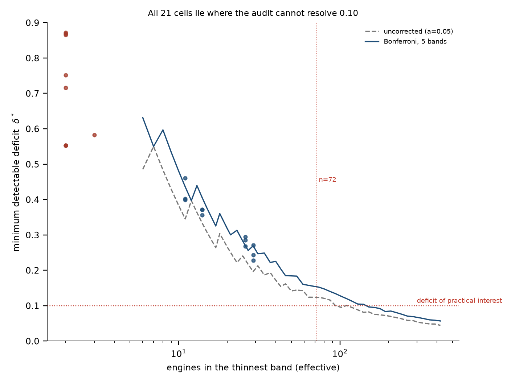
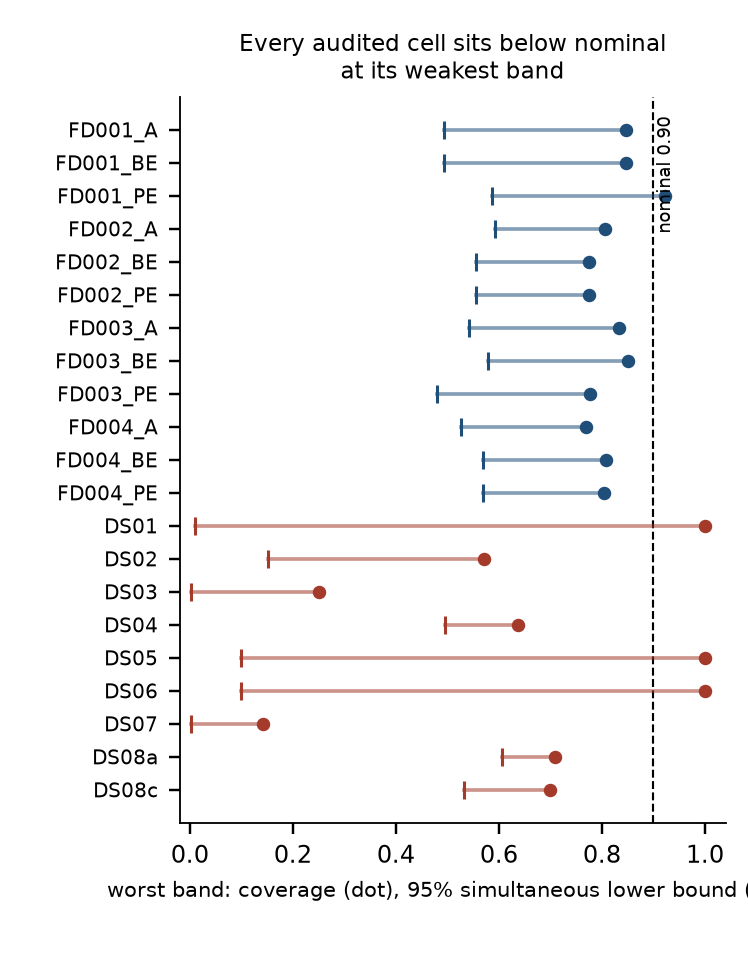
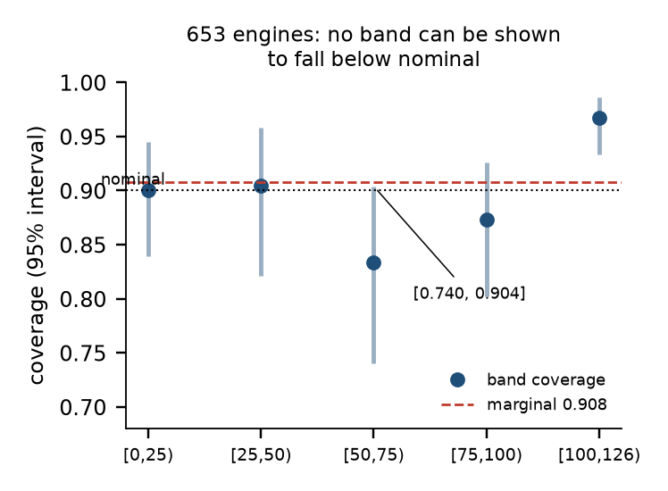

# What a RUL Coverage Table Can and Cannot Show: Detectability Limits of Conditional Coverage Audits

*Draft — 2026-11-02 — target: IEEE Transactions on Instrumentation and Measurement*

---

## Abstract

Conditional coverage — the property that a prediction interval covers its nominal
fraction of outcomes *within each operating regime or lifetime band* — is routinely
asserted on the basis of a five-row table of band-wise coverage. We show that on the two
standard RUL benchmarks this assertion lies outside what the data can resolve, and we
quantify the gap.

Two quantities are separated that the literature conflates. The **level error**
$m=\hat\alpha-(1-\tau)$ is what a marginal PICP reports. The **shape error**
$c_b=p_b-\hat\alpha$ is the only information a band table adds. Testing $c_b=0$ and
reading the result as $m+c_b=0$ is a substitution that passes silently whenever the
interval width is wrong in the same direction everywhere.

The **minimum detectable deficit** $\delta^\ast(n_b)$ of a band test is computed in
closed form and verified against Monte Carlo to within 0.01. Reaching $\delta^\ast=0.10$
at 80% power with five bands requires **143 engines per band, i.e. 715 per test set** —
seven times what any C-MAPSS subset provides. On C-MAPSS the twelve (backbone × subset)
cells we audit hold 11–29 engines in their smallest band, giving
$\delta^\ast=0.23$–$0.46$; all twelve pass the marginal test ($p>0.05$) while the
simultaneous 95% lower bound on their worst band is 0.48–0.59 against a nominal 0.90. On
nine N-CMAPSS fleets the cycle-level test sets carry 175–384 rows but design effects of
1.0–16.0, leaving 2–3 effective observations in the smallest band and
$\delta^\ast=0.55$–$0.87$; omitting the design effect understates $\delta^\ast$ by a
median factor of 1.8 and up to 3.9.

Pooling the four C-MAPSS fleets to 653 engines — the largest configuration the benchmark
admits — narrows but does not close the gap ($\delta^\ast=0.079$–$0.131$). No band can
then be shown to fall below nominal: the tightest case, $[50,75)$, is 0.833 with a 95%
interval of $[0.740,0.904]$ that still straddles 0.90. What the pooled data *can* say is
that the marginal is nominally perfect (0.908, Wilson $[0.884,0.928]$, $p=0.557$) while a
randomised PIT rejects uniformity at $p<10^{-4}$ — the distribution is misshapen, and the
coverage table cannot see it.

The constructive finding runs the other way: on the same 21 cells the marginal test
rejects in 0 of 12 C-MAPSS cases, and a randomised-PIT uniformity test rejects in 8 of
12. Conditional *coverage* is not decidable at these sample sizes; conditional
*distribution* is.

We argue that $\delta^\ast$ is a property of the evaluation set and the binning scheme,
not of the predictor, so the limit applies to every method evaluated on these benchmarks
alike. A three-item reporting protocol — publish $\delta^\ast$, publish simultaneous
bounds rather than point estimates of the worst band, and bin by equal count rather than
equal width — is given, together with the sample sizes at which each becomes
informative.

**Index Terms** — remaining useful life, prediction intervals, conditional coverage,
calibration, statistical power, C-MAPSS, N-CMAPSS.

---

## I. Introduction

A probabilistic RUL predictor is now expected to deliver intervals, not just point
estimates, and the standard evidence that the intervals are trustworthy is a coverage
table: nominal level in one column, empirical coverage in another, sometimes split by
operating condition or by lifetime band. A recent and representative phrasing is
"well-calibrated 95% confidence intervals with coverage ranging from 93.5% to 95.2%"
\cite{sharma2025}; another reports that a calibration step "increased coverage by 18% for
FD001 … 37.1% for FD004" \cite{deq2025}; a third concludes that "PICP increased from 0.83
and 0.87 to 0.91 … signifying well-calibrated uncertainty bounds" \cite{hybrid2025}.

Each of these is a statement about the **marginal** coverage $\hat\alpha$. None of them
is a statement about conditional coverage, and the step from one to the other is usually
made in a single sentence: the bands are printed, they look close to each other, and the
conditional claim follows.

This paper asks a narrower question than "is the calibration good". It asks: **given the
size of the evaluation set, what could the table have shown?** The answer is a number,
and on the standard benchmarks that number is larger than the effect anyone is trying to
detect.

### Contributions

1. **A decomposition that names the substitution** (§II). Level error $m$ and shape error
   $c_b$ are separated, and the common reading of a band table is identified as a test of
   $c_b$ reported as evidence about $m+c_b$.

2. **A closed-form detectability limit** (§III-A), verified against Monte Carlo, and the
   observation that it depends only on the label multiset and the bin edges — not on the
   predictor (§III-B, Proposition 1). Consequently the limit binds every method evaluated
   on a given benchmark, including methods not yet proposed.

3. **A design-effect correction for cycle-level test sets** (§III-C), with measured
   values of 1.0–16.0 on N-CMAPSS and the resulting 1.8× (median) understatement of
   $\delta^\ast$ when the correction is omitted.

4. **A complete audit of 21 evaluation cells** across C-MAPSS (3 backbones × 4 subsets)
   and N-CMAPSS (9 fleets), reporting $\delta^\ast$, simultaneous bounds and randomised
   PIT for each (§IV). All 21 have fewer than 143 effective engines in their smallest
   band.

5. **A separation of what is and is not decidable** (§IV-C–D). At 653 engines no band
   can be shown to fall below nominal, but the same data reject distributional
   uniformity decisively. The audit can establish that a model is misspecified long
   before it can establish *where*.

6. **A three-item protocol** (§V) with the sample sizes at which each item becomes
   informative, plus an equal-count binning rule that recovers 1.2–1.6× of the lost
   per-band sample size at no cost.

We do not claim that any cited conclusion is false. We claim that the reported evidence
cannot distinguish it from its opposite, and we give the arithmetic that says so.

---

## II. What a Band Table Estimates

### A. Notation

Let the nominal level be $1-\tau$ (0.90 throughout). For engine $i$ with predictive
distribution $F_i$ and realised label $Y_i$ (capped at $S$), the central interval
$[L_i,U_i]$ and coverage indicator

$$E_i=\mathbf 1\{L_i\le Y_i\le U_i\},\qquad
\hat\alpha=\frac1n\sum_{i=1}^n E_i,\qquad
p_b=\frac1{n_b}\sum_{i\in b}E_i ,$$

where $b$ indexes $K$ bands of the label with $n_b=|b|$.

### B. The decomposition

$$\underbrace{p_b-(1-\tau)}_{\text{total}}=\underbrace{(\hat\alpha-(1-\tau))}_{m:\ \text{level}}+\underbrace{(p_b-\hat\alpha)}_{c_b:\ \text{shape}} . \tag{1}$$

The three terms are not interchangeable and they are not measured with the same
precision. $m$ is estimated from all $n$ engines; $c_b$ from $n_b$.

A band table's marginal row reports $m$. Its band rows report $m+c_b$. Its *internal
consistency* — the thing a reader visually checks when the rows look alike — is $c_b=0$.

Now consider the sentence "band coverage ranges from 0.83 to 0.96, close to the nominal
0.90, so the intervals are conditionally calibrated". If $\hat\alpha=0.96$, the range
0.83–0.96 is consistent with $c_b$ being large and negative in the low bands; the model
is over-covering on average and under-covering where it matters. If instead
$\hat\alpha=0.83$, the same range is consistent with a model that under-covers
everywhere and is *least* bad in the low bands. The table alone cannot tell these apart,
because it never displays $m$ and $c_b$ separately.

Across our 21 cells, $m$ spans $-0.095$ to $+0.100$. Twelve of twelve C-MAPSS cells pass
the marginal binomial test at $\alpha=0.05$; the largest $|m|$ is 0.057.

### C. Why the substitution is not harmless

Two failure modes hide behind it, and they point in opposite directions.

**Over-coverage.** Nine of the twelve C-MAPSS cells have $\hat\alpha>0.90$, up to 0.957;
three N-CMAPSS fleets reach $\hat\alpha=1.000$. Wide intervals cover everything. Every
band then reads close to 1.0 and $c_b\approx0$, so the table looks *best* exactly when
the intervals carry the least information. Reporting PICP alone cannot distinguish
"accurate" from "uninformative", and reporting a coverage *increase* as evidence of
improved calibration \cite{deq2025} is, in the limit, rewarding width.

**Under-coverage concentrated in one band.** §IV-C exhibits a case with
$\hat\alpha=0.908$ and $p_{[50,75)}=0.833$. The marginal number is correct and the model
is still wrong by 7.5 points where the maintenance decision is made.

A sharpness read-out is therefore not optional. We use the mean 90% interval width, the
Winkler score, and the area between the empirical coverage curve and the diagonal over
nominal levels $0.1,\dots,0.9$; the last is not reduced by widening, since widening moves
the whole curve rather than bending it toward the diagonal.

---

## III. Detectability

### A. Minimum detectable deficit

For one band, testing $H_0:p_b=p_0$ against a two-sided alternative with a binomial test
of size $\alpha_b$ and power $1-\beta$ detects the smallest $|\delta|$ such that

$$\pi(n_b,p_0,\delta)=\Pr_{p_0-\delta}\!\left(X\le c^-_{\alpha_b}\right)
+\Pr_{p_0-\delta}\!\left(X\ge c^+_{\alpha_b}\right)\ge 1-\beta ,$$

with $c^\pm$ the binomial critical values at $p_0$. We solve this on a grid
(`core.mde`), with $\alpha_b=\alpha/K$ for $K$ bands.

Table I compares the closed form with 4000 Monte Carlo replications at $p_0=0.90$,
$\delta=0.10$, $\alpha=0.05$: agreement is within 0.012 everywhere, so the remaining
statements can be made analytically.

**TABLE I — Closed-form vs empirical power**

| $n_b$ | empirical | analytic | $\delta^\ast$ |
|---:|---:|---:|---:|
| 20 | 0.197 | 0.196 | 0.266 |
| 40 | 0.395 | 0.407 | 0.172 |
| 80 | 0.656 | 0.654 | 0.121 |
| 150 | 0.910 | 0.911 | 0.083 |
| 300 | 0.998 | 0.997 | 0.056 |



*Figure 2. Minimum detectable deficit against engines per band, with the 21 cells placed
on the curve. Every cell sits in the region where $\delta^\ast$ exceeds any effect the
literature reports.*

The threshold that matters: $\delta^\ast\le0.10$ requires $n_b\ge143$ per band with
Bonferroni over five bands, or $n_b\ge94$ without correction. For a five-band table that
is **715 engines per test set**; for three bands, 381. A C-MAPSS subset supplies 100.

### B. The limit does not depend on the model

**Proposition 1.** *For a fixed nominal level, fixed band edges, and a fixed label
multiset $\{Y_i\}$, the band counts $\{n_b\}$ — and therefore $\delta^\ast$ — are
independent of the predictor.*

This is immediate ($n_b$ counts labels, not predictions), and it has a consequence worth
stating plainly: the detectability of a conditional-coverage claim on a given benchmark
is fixed before any method is trained. A better model, a conformal wrapper, a Bayesian
treatment, or a calibration layer cannot move it. On the standard C-MAPSS protocol —
100 test engines per subset, five equal-width RUL bands — the smallest band holds on the
order of ten engines and $\delta^\ast$ is near 0.4 for *every* published method, past and
future. The deficit of 715 versus 100 is not a gap that better modelling can close.

Proposition 1 also means that $\delta^\ast$ can be reported by a reader who has only the
test-set labels, which is what makes it a usable reviewing criterion rather than a claim
about someone's code.

### C. Cycle-level test sets need a design effect

N-CMAPSS test sets contain many rows per engine: 40–100 flight cycles. Coverage
indicators within an engine are strongly dependent, so $n$ is not the number of Bernoulli
trials. With $\bar m$ the mean cluster size and $\rho$ the intra-cluster correlation of
$E_i$ (one-way random effects),

$$\text{DE}=1+(\bar m-1)\rho,\qquad n_{\text{eff}}=n/\text{DE}. \tag{2}$$

On the nine fleets DE ranges from 1.00 to 16.00. DS08a has 329 rows and 6 engines; DE =
16.0 leaves 20 effective observations. Any power statement computed from the row count is
then wrong by a factor of $\sqrt{\text{DE}}=4$ in precision.

Table II quantifies the error of omitting the correction.

**TABLE II — $\delta^\ast$ with and without the design effect**

| fleet | $n$ | DE | naive min $n_b$ | naive $\delta^\ast$ | effective min $n_{\text{eff}}$ | corrected $\delta^\ast$ | ratio |
|---|---:|---:|---:|---:|---:|---:|---:|
| DS02 | 175 | 4.05 | 7 | 0.49 | 2 | 0.87 | 1.8× |
| DS03 | 384 | 7.19 | 4 | 0.56 | 2 | 0.87 | 1.6× |
| DS04 | 308 | 14.12 | 10 | 0.57 | 2 | 1.00 | 1.8× |
| DS07 | 308 | 3.96 | 7 | 0.49 | 2 | 0.87 | 1.8× |
| DS08a | 329 | 16.00 | 12 | 0.46 | 2 | 1.00 | 2.2× |
| DS08c | 201 | 11.84 | 41 | 0.25 | 3 | 1.00 | 3.9× |

Median understatement 1.8×, worst 3.9×. DS08c is the instructive case: by row count its
smallest band holds 41 observations and looks adequate for a 0.25 deficit; by effective
count it holds 3 and can detect nothing below a total failure.

---

## IV. What the Benchmarks Support

### A. C-MAPSS: twelve cells, twelve undecidable

Setup. Three backbones (A, BE, PE) × four subsets (FD001–FD004); the calibration layer is
the 66-parameter location-scale MLP with a right-censored (Tobit) likelihood, width
chosen by cross-fitting on the development sample to hit 0.90. Test set 653 engines total
(official 707; 54 discarded, see §VII). Bands are equal-width in true RUL:
$[0,25),[25,50),[50,75),[75,100),[100,126)$. Coverage is evaluated at the 90% level.

**TABLE III — C-MAPSS audit**

| cell | $n$ | $\hat\alpha$ | $m$ | worst band | $p_b$ | $c_b$ | min $n_b$ | $\delta^\ast$ | 95% sim. lower |
|---|---:|---:|---:|---|---:|---:|---:|---:|---:|
| FD001_A | 93 | 0.935 | +.035 | [50,75) | 0.85 | −.089 | 11 | 0.40 | 0.49 |
| FD001_BE | 93 | 0.925 | +.025 | [50,75) | 0.85 | −.079 | 11 | 0.46 | 0.49 |
| FD001_PE | 93 | 0.957 | +.057 | [50,75) | 0.92 | −.034 | 11 | 0.40 | 0.59 |
| FD002_A | 235 | 0.902 | +.002 | [50,75) | 0.81 | −.096 | 29 | 0.27 | 0.59 |
| FD002_BE | 235 | 0.932 | +.032 | [50,75) | 0.77 | −.158 | 29 | 0.23 | 0.56 |
| FD002_PE | 235 | 0.911 | +.011 | [50,75) | 0.77 | −.136 | 29 | 0.24 | 0.56 |
| FD003_A | 97 | 0.948 | +.048 | [75,100) | 0.83 | −.115 | 14 | 0.36 | 0.54 |
| FD003_BE | 97 | 0.938 | +.038 | [50,75) | 0.85 | −.088 | 14 | 0.37 | 0.58 |
| FD003_PE | 97 | 0.938 | +.038 | [75,100) | 0.78 | −.160 | 14 | 0.37 | 0.48 |
| FD004_A | 228 | 0.886 | −.014 | [50,75) | 0.77 | −.117 | 26 | 0.29 | 0.53 |
| FD004_BE | 228 | 0.877 | −.023 | [50,75) | 0.81 | −.070 | 26 | 0.29 | 0.57 |
| FD004_PE | 228 | 0.899 | −.001 | [75,100) | 0.80 | −.094 | 26 | 0.27 | 0.57 |



*Figure 1. Worst-band coverage (dot) and the simultaneous 95% lower bound (tick) for all
21 audited cells. Nominal is 0.90. Nothing reaches it.*

Three readings.

*Marginal coverage is fine.* Twelve of twelve pass at $\alpha=0.05$, worst $|m|=0.057$.

*Nothing else is.* The simultaneous 95% lower bound on the worst band is 0.48–0.59. The
statement "the worst band covers at least 0.90" is firmly rejected, but the statement
"at least 0.48" carries no operational content. $\delta^\ast$ is 0.23–0.46, so these
cells could only have detected a band collapsing to 0.44–0.67.

*The point estimates are as noisy as the effect.* Bootstrapping engines 2000 times, the
90% interval for the worst band's coverage is 0.24–0.33 wide in the four C-MAPSS cells —
wider than the 0.10 deficit the table is being read for. The identity of the worst band
survives resampling in only 54–86% of replicates, and the full band ordering changes in
74–93%.

That last number deserves emphasis because it is the one a reader intuitively trusts: the
*ordering* of a five-row table is not identified at $n_b\approx20$.

### B. N-CMAPSS: the row count is not the sample size

Nine fleets (DS01–DS08c; DS08d excluded for an upstream archive defect), one MLP
backbone, pooled fit, cap $S=100$, bands $[0,20),\dots,[80,101)$ at the 90% level, with
the design-effect correction of §III-C applied before any power statement. Full table in
the supplement; the essentials:

- $\hat\alpha$ spans 0.805–1.000. Three fleets sit at exactly 1.000 — over-coverage, not
  success.
- Effective sample size in the smallest band is **2–3** on all nine fleets.
- $\delta^\ast=0.55$–$0.87$. These cells cannot detect a band at 0.25 coverage.
- The observed worst-band coverages (0.14 on DS07, 0.25 on DS03) are *not reportable*:
  their bands hold 2 effective observations. They are consistent with catastrophe and
  with correctness alike.

This is the sharpest form of the argument. On a benchmark with 175–384 rows per fleet, a
conditional-coverage statement has no content. The rows are cycles, not engines.

### C. Pooled: the widest configuration the benchmark admits

Concatenating the four C-MAPSS fleets (arm A, $n=653$) gives the largest sample this
benchmark can produce. $\delta^\ast$ falls to 0.079–0.131 and the thinnest band holds 84
engines.

**TABLE IV — C-MAPSS pooled, 653 engines, 90% intervals**

| band | $n$ | coverage | $c_b$ | bias | $\delta^\ast$ | 95% interval |
|---|---:|---:|---:|---:|---:|---|
| [0,25) | 141 | 0.901 | −.007 | +3.26 | 0.096 | [0.839, 0.945] |
| [25,50) | 84 | 0.905 | −.003 | +1.22 | 0.131 | [0.821, 0.958] |
| **[50,75)** | **90** | **0.833** | **−.075** | **+5.81** | **0.129** | **[0.740, 0.904]** |
| [75,100) | 126 | 0.873 | −.035 | +7.38 | 0.109 | [0.802, 0.926] |
| [100,126) | 212 | 0.967 | +.059 | −5.72 | 0.079 | [0.933, 0.987] |



*Figure 3. Pooled 653 engines. Point estimates with 95% intervals. The marginal is
nominally perfect; the tightest band interval still straddles 0.90.*

Three readings, and the third is the point.

*The marginal is nominally perfect.* $\hat\alpha=0.908$, Wilson $[0.884,0.928]$,
$p=0.557$. By the standard reporting convention this model is calibrated.

*The tightest condition interval the benchmark can produce still straddles nominal.* Band
$[50,75)$ is 0.833 with a 95% interval of $[0.740,0.904]$. The upper limit sits four
thousandths below the nominal level — a hair's breadth, and not enough. **No band can be
shown to fall below 0.90 even with every engine in the benchmark.** The honest statement
is "the $[50,75)$ band could be as low as 0.74", not "the $[50,75)$ band is miscalibrated".

*What is decidable is a different question.* The randomised PIT on the same predictions
and labels rejects uniformity at $p<10^{-4}$, and its Spearman correlation with $\hat y$
is $+0.151$ ($p=10^{-4}$). The predictive distribution is misshapen and its error drifts
with the prediction. The coverage table, at this sample size, cannot see either fact.

So pooling buys a factor of 3–4 in $\delta^\ast$ and still does not buy a verdict. That
is the paper's central negative result, stated in its strongest form: on C-MAPSS the
question "is this band calibrated" is out of reach at every scale the benchmark offers,
including the full 653-engine pool. The gap is not 715 versus 100 — it is 715 versus 653,
and the residual shortfall is precisely why the band table returns "0.833 [0.740, 0.904]"
instead of a decision.

### D. What is decidable: the distribution, not the band

Everything above is negative. One result is not, and it is worth separating cleanly
because it defines what an audit at this scale *can* deliver.

On the same twelve C-MAPSS cells, the marginal coverage test rejects in **0 of 12**
($p>0.08$ throughout). A randomised-PIT Cramér–von Mises test rejects uniformity in
**8 of 12** ($p<0.05$); on the nine N-CMAPSS fleets it rejects in 9 of 9. Under the null
of a correct predictive distribution both tests should reject at 5%, i.e. 0.6 times out
of twelve.

The PIT result is not a power calculation, and we do not present it as one — a
distributional test and a coverage test are sensitive to different alternatives, and the
CvM statistic can fire on misshapenness that leaves coverage intact. What it establishes
is narrower and sufficient: **the predictive distributions are wrong, the marginal
coverage number is not evidence that they are right, and the band table cannot say where
the error is.**

That asymmetry is the practical content of the audit. A PIT check costs nothing, needs no
binning, and answers "is this model's uncertainty usable at all". A band table answers
"which regime is worst", and at $n_bpprox20$ it answers unreliably. The two should be
reported together, in that order of confidence.

### E. A caveat on pooling

The four fleets differ (FD001/FD003 single-condition, FD002/FD004 multi-condition), so
Table IV describes a mixture, not any one fleet, and the $[50,75)$ deficit cannot be
attributed to a specific operating regime without further work. Its role here is to
demonstrate the scale effect, not to replace per-fleet analysis. We return to this in
§VII.

---

## V. Protocol

Three requirements, in order of how much they change the conclusion.

**R1 — Report $\delta^\ast$ alongside every band table.** A $p$-value of 0.31 means
"excluded every deficit above 0.03" when $\delta^\ast=0.03$ and "excluded nothing" when
$\delta^\ast=0.44$. The two are typographically identical. Minimum implementation: add
$n_b$ and $\delta^\ast$ columns. Both follow from the labels and the bin edges
(Proposition 1), so a reviewer can compute them without the authors' code.

**R2 — Report a simultaneous lower bound on the worst band, not its point estimate.**
At $n_b=26$ a point estimate of 0.77 has a 95% interval of roughly $[0.57,0.90]$; quoting
"0.77 versus a nominal 0.90" invites the reader to treat a 13-point gap as measured when
its sampling error is of the same order. A Bonferroni–Clopper–Pearson bound is crude,
conservative, and always computable, which is exactly what is wanted at this sample size.

**R3 — Bin by equal count, and pool until $\delta^\ast$ is below the effect of interest.**
Equal-width RUL bands put the fewest engines where the decisions are. Equal-count bands
cost nothing but a rephrasing ("the lowest 20% of RUL" rather than "RUL in $[25,50)$") and
recover 1.2–1.6× of the lost per-band size:

**TABLE V — band counts, equal width vs equal count**

| fleet | equal width | equal count |
|---|---|---|
| FD001 | 19, **11**, 13, 22, 28 | 19, 18, 19, 17, 20 |
| FD002 | 58, **29**, 31, 45, 72 | 47, 47, 46, 46, 49 |
| FD003 | 15, **14**, 20, 18, 30 | 20, 19, 17, 18, 23 |
| FD004 | 49, 30, **26**, 41, 82 | 46, 45, 46, 42, 49 |
| pooled 653 | 141, **84**, 90, 126, 212 | 127, 132, 127, 135, 132 |

The gain is modest on FD003, whose label density happens to be near-uniform, and large on
FD004, where the cap at 125 and the cutoff distribution both pile mass into the top band
(82 engines versus 26 in the thinnest band). Even after this, no single fleet reaches
143 — the requirement is 1.4× the entire benchmark. The remaining options are pooling
(§IV-C, with the heterogeneity caveat, reaching 131 at best) or stating explicitly that
the data cannot decide.

A fourth item, not a requirement but a strong recommendation: report randomised PIT
alongside coverage. On our cells the PIT rejects uniformity in 8 of 12 C-MAPSS cells
while the marginal test rejects in 0 of 12, so it is the more sensitive instrument for
*detecting* that something is wrong — even though it cannot localise the failure the way
a band table can. Coverage and PIT answer different questions and neither substitutes for
the other.

---

## VI. Relation to Prior Evaluation Practice

That PICP alone is insufficient is not a new observation. The forecasting literature has
long noted that PICP is blind to one-sided bias in the interval bounds and has
recommended quantile coverage and PIT histograms in its place \cite{soil2025}; binned
coverage analyses have exposed homoscedastic conformal methods that fail precisely in the
tail while passing on aggregate \cite{mpr2026}; and the general impossibility of
distribution-free conditional coverage is established \cite{barber2021}.

What is missing, and what this paper supplies, is the **quantitative link between sample
size and what a conditional-coverage claim can mean**. Prior critiques establish that
aggregate metrics can hide conditional failure; they do not say how many engines are
needed to see it, and therefore cannot tell a reader whether a given table's silence is
evidence of absence or absence of evidence. On the RUL benchmarks the answer turns out to
be "715 engines per test set", which no standard protocol provides and which
exceeds the 707 engines the benchmark contains.

The three papers sampled in §I are representative rather than exceptional: reporting only
$\hat\alpha$ is the norm. We do not assert their conclusions are false. We assert that at
$n\approx100$ per subset and five bands, no analysis — theirs, ours, or anyone's — could
have established them.

---

## VII. Limitations

1. **Pooling heterogeneity.** Table IV mixes four fleets with different operating
   conditions. The $[50,75)$ deficit is a property of the mixture; attributing it to a
   regime requires per-fleet power that does not exist. We report it as a demonstration
   of the scale effect and flag the confound explicitly.
2. **Architecture family.** The three C-MAPSS backbones share an architectural family;
   N-CMAPSS has one MLP plus one ridge variant. Cross-backbone agreement rules out seed
   noise, not architecture.
3. **Evaluation set.** 653 of the official 707 C-MAPSS engines; the 54 discarded average
   RUL 119–157 against 72–80 for those retained, i.e. the healthiest engines are
   systematically excluded. All coverage numbers are conditional on that selection.
4. **ICC approximation.** (2) assumes balanced clusters; N-CMAPSS engines carry 40–100
   cycles each. $n_{\text{eff}}$ should be read as an order of magnitude.
5. **Conservative bounds.** Bonferroni is not the tightest simultaneous procedure. A
   joint multinomial construction would narrow the bounds of Table III by perhaps 10–20%;
   it would not change any verdict, since the gap to 0.90 is 0.3–0.4.
6. **Bands on true RUL only.** Binning on $\hat y$ yields a different table answering a
   different question ("is the model honest about its own predictions"). We report the
   true-RUL version because it is the one tied to maintenance decisions, and mixing the
   two is itself a common source of confusion.

---

## VIII. Conclusion

A coverage table is a five-row estimate of five proportions, computed from roughly twenty
engines per row, and read as a statement about conditional calibration. The arithmetic
says it cannot carry that reading: at $n_b\approx20$ the smallest detectable deficit is
0.23–0.46, the bootstrap interval for the worst band is 0.24–0.33 wide, and the ordering
of the rows changes under resampling three times in four.

This is not a criticism of any particular model. It follows from the label multiset and
the bin edges, so it applies identically to every method evaluated on C-MAPSS with the
standard protocol — which is why it is worth stating as a property of the benchmark
rather than of a paper.

What can be done is unglamorous and cheap: publish the minimum detectable deficit next to
the coverage, publish a simultaneous bound instead of a point estimate, bin by count
rather than width, and pool when the question allows. On C-MAPSS, doing so moves the
audit from "nothing is decidable" to a specific, reproducible statement: marginal
coverage 0.908, band $[50,75)$ at 0.833 with interval $[0.740,0.904]$. That is a smaller
claim than the ones usually made — it stops short of declaring the band miscalibrated —
and it is the largest claim these benchmarks can support.

---

## Appendix: Reproduction

All numbers regenerate from `scripts/audit/` against the frozen endpoints in
`experiments/cal/audit/*.npz`:

```
python scripts/audit/run_audit.py --glob "experiments/cal/audit/FD*_*.npz" \
    --out experiments/cal/audit/audit_cmapss.json
python scripts/audit/run_audit.py --glob "experiments/cal/audit/DS*.npz" \
    --bands 100 --out experiments/cal/audit/audit_ncmapss.json
python scripts/audit/design.py
python scripts/audit/stability.py
```

The endpoint dump itself is produced by `scripts/cal/dump_endpoints.py` (C-MAPSS) and
`scripts/ncmapss/dump_nc.py` (N-CMAPSS), both of which cross-check a numpy forward pass
against the torch implementation and refuse to write output if they disagree (observed
max deviation $2.8\times10^{-14}$).

---

## References (to be completed)

- [sharma2025] K. Sharma, "Uncertainty-aware deep learning framework for RUL prediction
  in turbofan engines with learned aleatoric uncertainty," arXiv:2511.19124, Nov. 2025.
- [deq2025] S. P. and Y. S. B., "A deep equilibrium model for remaining useful life
  estimation of aircraft engines," *Electronics*, vol. 14, no. 12, art. 2355, 2025.
- [hybrid2025] "Novel hybrid prognostics of aircraft systems," *Electronics*, vol. 14,
  no. 11, art. 2193, 2025.
- [soil2025] "A review of data mining approaches for spatial monitoring of soil
  pollution," 2025. (PICP one-sided bias; QCP and PIT as alternatives.)
- [mpr2026] "Calibrated conformal prediction intervals for microphysical process rates,"
  2026. (Binned coverage exposes tail failure hidden by aggregate PICP.)
- [barber2021] R. F. Barber, E. J. Candès, A. Ramdas, R. J. Tibshirani, "The limits of
  distribution-free conditional predictive inference," *Information and Inference*, 2021.
